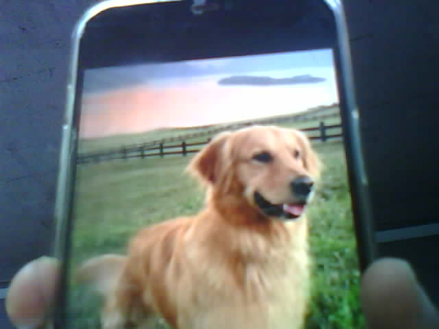
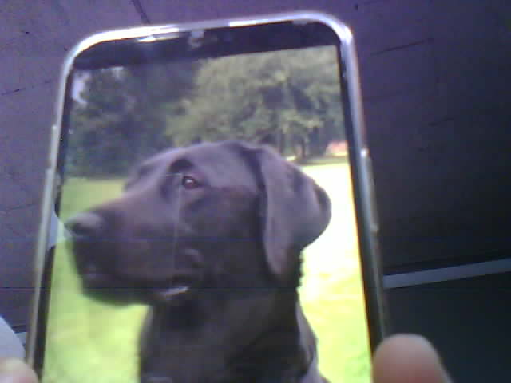

# First test with the real ESP32-CAM (16 November 2026)

First end to end run of the recognition with the real camera: ESP32-CAM photo, WiFi, AI on the laptop, feeder decision. Made with `firmware/esp32_camera_test` and `ai_v2/tools/live_test.py` in guided mode.

 

*Biscuit (left) and Mochi (right) as the ESP32-CAM sees them: dog photos shown on a phone screen.*

## Setup

| Item | Value |
|---|---|
| Camera | ESP32-CAM (AI Thinker), 640 x 480 JPEG, flashed through the DevKit (circuit 6) |
| Network | 2.4 GHz WiFi, signal about -57 dBm |
| Enrolled dogs | Biscuit (golden retriever, 11 reference photos), Mochi (black Labrador, 12 reference photos) |
| What the camera saw | Dog photos on a phone screen, 15 to 25 cm away (no real dog yet) |
| Meal of | Biscuit: Biscuit should get SERVE, Mochi BLOCK, a never enrolled dog "unknown dog" |
| Command | `live_test.py --meal-dog biscuit --plan biscuit:4,mochi:4,unknown:4` |

## Results

| Shown | Run 1 | Run 2 |
|---|---|---|
| Biscuit | 4/4 | 3/4 |
| Mochi | 2/4 | 4/4 |
| Never enrolled dog | 2/4 | 4/4 |
| **All** | **8/12 (67 %)** | **11/12 (92 %)** |

| Measure | Value |
|---|---|
| Confidence when right | Biscuit 0.81 to 0.91, Mochi 0.68 to 0.83 (accepted from 0.485) |
| Lead over the other dog | 0.42 to 0.75 (needs 0.08) |
| Never enrolled dog | Confidence 0.31 to 0.45, so correctly rejected |
| Time per check | Photos about 0.1 s, AI 0.3 to 0.6 s |

## What went wrong

Every wrong check came at the start or end of a group, while the phone was being swapped or moved: the camera still saw the previous dog (run 1, check 5 and run 1, check 9) or no dog at all (run 1, checks 6 and 10; run 2, check 4). With a dog clearly in front of the camera, every answer was right. These are test setup errors, not recognition errors.

## Limits

1. Photos on a phone screen, not real dogs: real dogs move, turn and are lit differently, so expect lower scores.
2. The live photos may be the same pictures used for enrollment, which makes matching easier. Next test: different photos of the same dogs, then a real dog.
3. 24 checks show that the chain works, not a reliable accuracy figure.

## Files

Each run folder holds the 2 photos of every check (`check_NNNN_1.jpg`, `check_NNNN_2.jpg`) and `results.jsonl` (one line per check, with the `truth` field filled by the guided mode).
