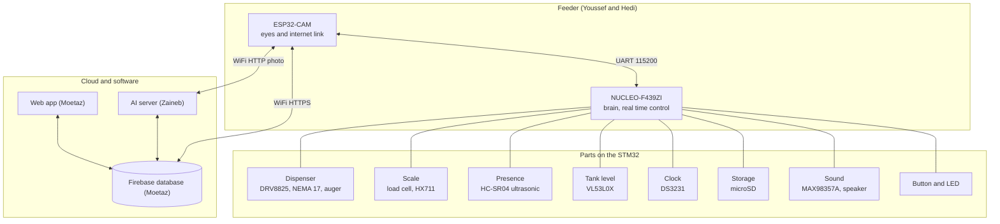
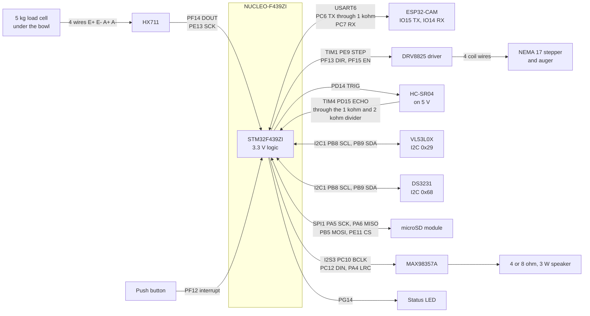
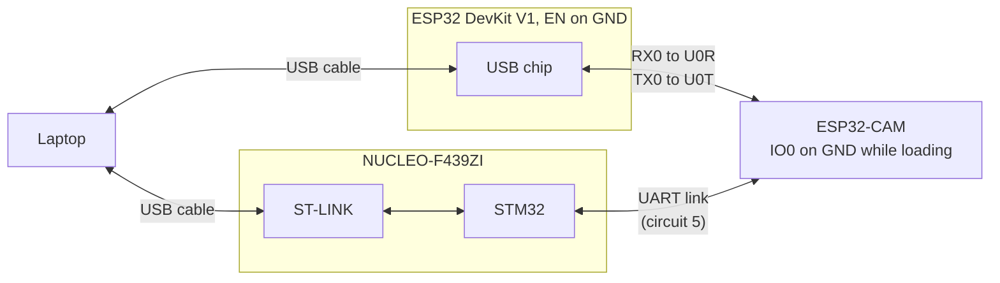
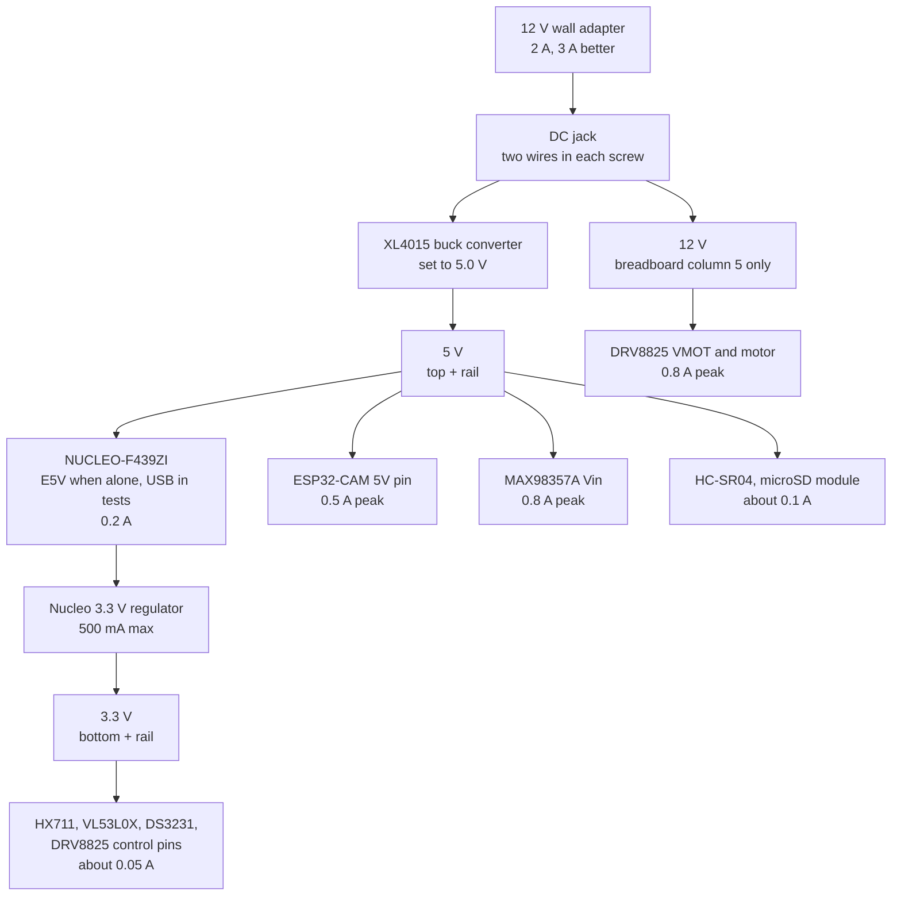
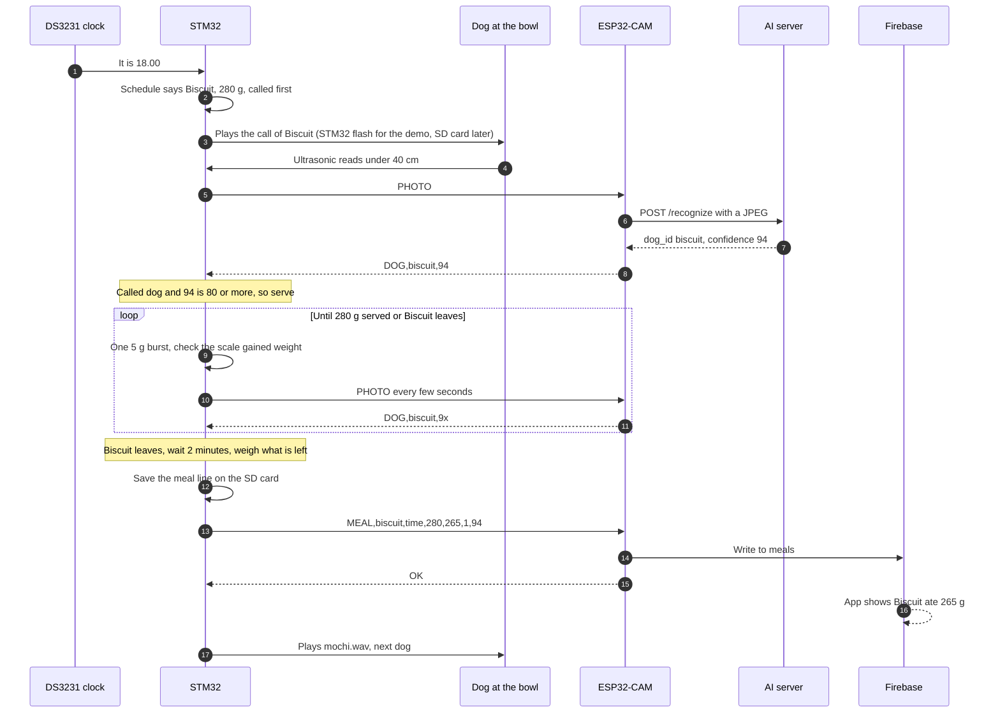
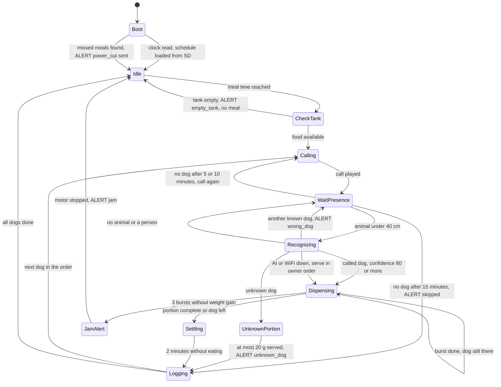
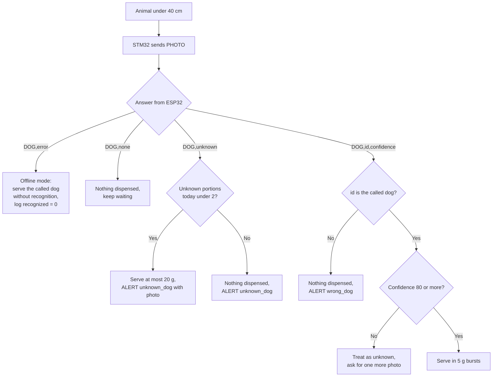
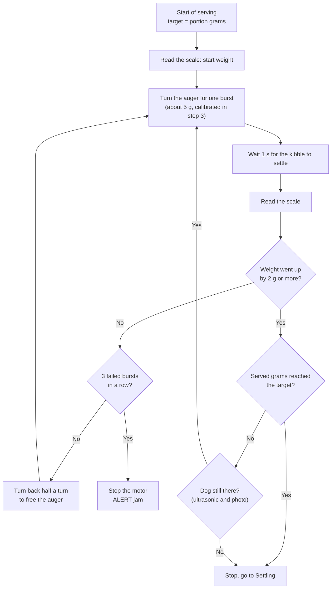
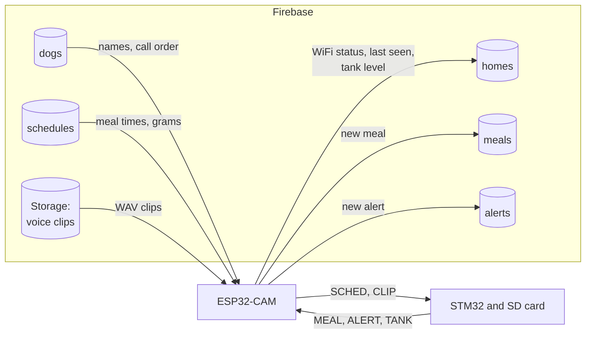
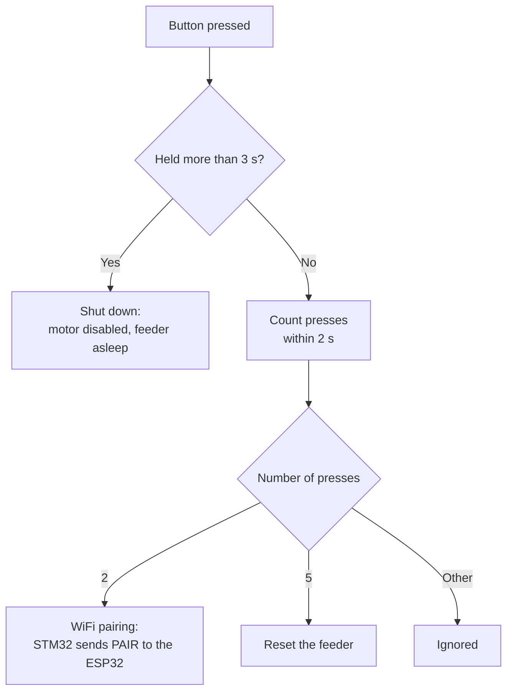

# Step 2: System architecture

How the parts from [step 1](01_hardware_list.md) fit together: which board does what, how they talk, how power flows, which pin each part uses, and how a meal runs from start to end.

**Updated on 10 November 2026** to the parts the team has or buys locally ([step 1](01_hardware_list.md)): ESP32-CAM camera board, DRV8825 motor driver, HC-SR04 ultrasonic sensor on 5 V, VL53L0X tank sensor. Every part is also drawn on the breadboard, hole by hole, in [circuits_by_part](circuits_by_part/README.md).

## Contents

| # | Section | What it shows |
|---|---|---|
| 1 | [Overview](#1-overview) | The whole system in layers: cloud, boards, parts |
| 2 | [Who decides what](#2-who-decides-what) | The job of the STM32 and the job of the ESP32 |
| 3 | [Connection diagram](#3-connection-diagram) | Every part, its bus and its pins |
| 4 | [Communication links](#4-communication-links) | Bus types, speeds, addresses, UART messages, loading programs |
| 5 | [Power](#5-power) | Power tree, voltages, currents, safety rules |
| 6 | [Pin plan](#6-pin-plan) | The exact pin for every wire |
| 7 | [One meal in time order](#7-one-meal-in-time-order) | Messages between STM32, ESP32, AI server and Firebase |
| 8 | [STM32 states](#8-stm32-states) | The feeder program as a state machine |
| 9 | [Decision at the bowl](#9-decision-at-the-bowl) | What happens for each AI answer |
| 10 | [Dispensing and jam check](#10-dispensing-and-jam-check) | How each 5 g burst is checked with the scale |
| 11 | [Failure handling](#11-failure-handling) | Jam, tank, WiFi, power cut |
| 12 | [Data with the database](#12-data-with-the-database) | What the feeder reads and writes in Firebase |
| 13 | [Button and LED](#13-button-and-led) | Press patterns and LED states |
| 14 | [Decisions to confirm](#14-decisions-to-confirm) | Open points for the team |

## 1. Overview

## 2. Who decides what

The STM32 is the **brain**: it runs the meal, owns the clock and the schedule copy, and keeps working when WiFi is down. The ESP32 is the **eyes and the internet link**: it only does what the STM32 asks and reports back.

| Decision or job | STM32 | ESP32 |
|---|---|---|
| Meal time (clock and schedule) | Yes | No |
| Playing the dog's call | Yes | No |
| Detecting an animal | Yes (ultrasonic) | No |
| Taking a photo and asking the AI server | No | Yes, when the STM32 asks |
| Deciding to dispense | Yes, from the AI answer | No |
| Motor, scale, tank level | Yes | No |
| Reading schedules and voice clips from Firebase | No | Yes, then sends them to the STM32 |
| Writing meals and alerts to Firebase | No | Yes, from messages sent by the STM32 |
| Offline logs | Yes (SD card) | No |
| WiFi pairing and status | No | Yes, reports the status to the STM32 |
| Correct time | Yes (DS3231) | Sends internet time once a day to correct it |

Why this split: if WiFi, the ESP32 or the AI server fails, the STM32 alone still feeds the dogs on time.

## 3. Connection diagram

Every arrow shows the bus and the STM32 pins it uses. Full pin table in [section 6](#6-pin-plan).

## 4. Communication links

| Link | Between | Type | Speed or setting |
|---|---|---|---|
| Feeder to cloud | ESP32 and Firebase | WiFi, HTTPS | |
| Recognition | ESP32 and AI server | WiFi, HTTP: JPEG photo in, dog id and confidence out | Answer within about 1 s |
| Boards | STM32 and ESP32-CAM | UART, 3.3 V, text lines ending with a newline | 115200 baud, 8N1 |
| Motor driver settings | DRV8825 | Microsteps set by wires (M2 to 3.3 V, M0 and M1 open); current set with the potentiometer | 1/16 step, about 1 A |
| Motor movement | STM32 and DRV8825 | STEP pulses from a timer, DIR and EN levels | 1/16 microsteps, 3200 steps per auger turn |
| Scale | STM32 and HX711 | 2 wire serial (clock and data) | 10 readings per second, gain 128 |
| Presence | STM32 and HC-SR04 | TRIG pulse of 10 us, ECHO pulse (through the divider) timed by TIM4 | One reading every 100 ms; distance in cm = pulse in us ÷ 58 |
| Sensors and clock | STM32, VL53L0X, DS3231 | I2C1 bus | 400 kHz |
| Storage | STM32 and microSD | SPI1 with FatFs | Up to 12 MHz |
| Sound | STM32 and MAX98357A | I2S3 with DMA | WAV, 16 kHz, 16 bit, mono; demo clips kept in STM32 flash, SD card later |
| Debug | STM32 and computer | ST-LINK virtual serial port (USART3, PD8, PD9) | 115200 baud |

### I2C addresses

| Device | Address | Note |
|---|---|---|
| VL53L0X | 0x29 | Fixed at power on |
| DS3231 | 0x68 | Real time clock |
| AT24C32 EEPROM on the DS3231 module | 0x57 | Present on most modules, not used |

### UART messages between the boards

One message per line, readable as text, so we can watch and type them in a serial monitor while testing. Every message gets `OK` or `ERR` back, so a lost message is noticed and sent again. Final format is fixed in step 5.

| Direction | Message | Meaning |
|---|---|---|
| STM32 to ESP32 | `PHOTO` | An animal is in front of the bowl: take a photo and ask the AI server |
| ESP32 to STM32 | `DOG,biscuit,94` | AI answer: dog id and confidence in percent |
| ESP32 to STM32 | `DOG,unknown,0` | An animal that is not one of the home's dogs |
| ESP32 to STM32 | `DOG,none,0` | No animal, or a person |
| ESP32 to STM32 | `DOG,error,0` | AI server or WiFi unavailable |
| STM32 to ESP32 | `MEAL,biscuit,1730900000,280,265,1,94` | Meal log: dog, time, grams served, grams eaten, recognized, confidence |
| STM32 to ESP32 | `ALERT,jam` | Alert to write to Firebase (skipped, unknown_dog, wrong_dog, jam, low_tank, empty_tank, power_cut) |
| STM32 to ESP32 | `TANK,62` | Tank level in percent |
| ESP32 to STM32 | `SCHED,biscuit,1,08:00,280,18:00,280` | Schedule for one dog: id, call order, then time and grams for each meal |
| ESP32 to STM32 | `CLIP,biscuit,8000` | A voice clip of 8000 bytes follows, to save on the SD card |
| ESP32 to STM32 | `TIME,1730900000` | Internet time to correct the clock |
| ESP32 to STM32 | `WIFI,1` | WiFi status: 1 connected, 0 offline, 2 pairing |
| STM32 to ESP32 | `PAIR` | Button pressed twice: start WiFi pairing |
| Both | `OK`, `ERR` | Reply to every message |

### Loading programs and reading logs

Each board gets its program and shows its messages through its own USB cable, so both can stay plugged into the same laptop at once.

| Board | Tool | Loading a program | Messages for debugging |
|---|---|---|---|
| NUCLEO-F439ZI | STM32CubeIDE | Through the ST-LINK on the Nucleo USB cable: one click on Run | USART3 (PD8, PD9) through the ST-LINK serial port, 115200 baud |
| ESP32-CAM | PlatformIO, board `esp32cam` | Through the DevKit USB chip ([circuit 6](circuits_by_part/06_esp32_cam_flashing/README.md)): IO0 on GND, press RST, upload at 115200, remove IO0, press RST | UART0 (U0T) through the DevKit, 115200 baud |

The DevKit is a tool, not a part of the feeder: it is plugged in only to load programs or read the ESP32-CAM messages. With both USB cables in, the laptop shows two serial ports, so the UART link between the boards can be watched from both ends.

## 5. Power

| Rail | Source | Loads | Peak current | Margin |
|---|---|---|---|---|
| 12 V | Adapter, 2 A (3 A better) | Motor driver, buck converter | About 1.6 A | Enough with 2 A, more margin with 3 A |
| 5 V | XL4015, 5 A | Nucleo, ESP32-CAM, amplifier, HC-SR04, microSD module | About 1.6 A | Buck gives 5 A |
| 3.3 V | Nucleo regulator, 500 mA | HX711, VL53L0X, DS3231, driver control pins, STM32 | About 0.2 A | Under half of the limit |

Rules:

1. **All grounds are connected together**: adapter, buck, Nucleo, ESP32-CAM, driver, amplifier. Without a common ground, UART and sensors give wrong values.
2. **Set the buck to 5.0 V with the multimeter before connecting anything** to it. A new XL4015 can come set to any voltage.
3. A 1000 uF capacitor sits at the driver 12 V input (column 5), and another on the 5 V rail next to the ESP32-CAM wires, so WiFi peaks do not restart it.
4. The motor driver needs its 12 V before the motor moves, and the motor wires are **never** plugged or unplugged while the driver is powered (this destroys the driver).
5. During tests the Nucleo runs from the laptop USB (power jumper JP3 on U5V). When the feeder runs alone, wire P6 joins the top + rail to E5V and JP3 goes to E5V (see the Nucleo user manual UM1974); the USB is then plugged in only after the adapter. Before circuit 7 the Nucleo 5V pin fed the top + rail for the tests (wire R1); from circuit 7 on the XL4015 feeds it and R1 is out for good, so two 5 V sources never meet.
6. On most DS3231 modules a charging circuit is fitted for a rechargeable LIR2032 cell. With a normal CR2032, remove the charging resistor or diode on the module.
7. **On the breadboard** the top + rail is 5 V, the bottom + rail is 3.3 V and both − rails are GND. 12 V is on no rail: only in column 5, the driver VMOT column. Column map in [circuits_by_part](circuits_by_part/README.md#board-and-column-map).
8. **Two wires in each jack screw**: the driver (column 5) and the XL4015 get separate 12 V wires, and the XL4015 output has its own GND wire to the rails, so no breadboard contact carries much more than 1 A. Wiring: [circuit 7](circuits_by_part/07_power/README.md).
9. **Set the XL4015 to 5.0 V with a multimeter before its output touches the board**: a new one can give up to 12 V.

## 6. Pin plan

Pins chosen to avoid the ones already used on the board by Ethernet (PA1, PA2, PA7, PB13, PC1, PC4, PC5, PG11, PG13), USB (PA8 to PA12, PG6, PG7) and the ST-LINK serial port (PD8, PD9). **Check every pin in STM32CubeMX and the user manual UM1974 before wiring**; CubeMX shows conflicts in red.

### NUCLEO-F439ZI

Header pin numbers follow the user manual UM1974: check each one on the board before plugging.

| # | Part | Signal | STM32 pin | Board label and header pin | Peripheral | Direction |
|---|---|---|---|---|---|---|
| 1 | DRV8825 | STEP | PE9 | D6 · CN10 pin 4 | TIM1 channel 1, pulse output | Out |
| 2 | DRV8825 | DIR | PF13 | D7 · CN10 pin 2 | GPIO | Out |
| 3 | DRV8825 | EN (low turns the motor on) | PF15 | D2 · CN10 pin 12 | GPIO, plus 10 kohm to 3.3 V so the motor stays off during a reset | Out |
| 4 | HX711 | DOUT | PF14 | D4 · CN10 pin 8 | GPIO | In |
| 5 | HX711 | SCK | PE13 | D3 · CN10 pin 10 | GPIO | Out |
| 6 | HC-SR04 | TRIG | PD14 | D10 · CN7 pin 16 | GPIO | Out |
| 7 | HC-SR04 | ECHO, through the divider | PD15 | D9 · CN7 pin 18 | TIM4 channel 4, input capture | In |
| 8 | VL53L0X and DS3231 | SCL | PB8 | D15 · CN7 pin 2 | I2C1 | Out |
| 9 | VL53L0X and DS3231 | SDA | PB9 | D14 · CN7 pin 4 | I2C1 | In and out |
| 10 | microSD | SCK | PA5 | D13 · CN7 pin 10 | SPI1 | Out |
| 11 | microSD | MISO | PA6 | D12 · CN7 pin 12 | SPI1 | In |
| 12 | microSD | MOSI | PB5 | D22 · CN7 pin 13 | SPI1 (PA7 avoided, used by Ethernet) | Out |
| 13 | microSD | CS | PE11 | D5 · CN10 pin 6 | GPIO | Out |
| 14 | MAX98357A | BCLK | PC10 | D45 · CN8 pin 6 | I2S3 CK | Out |
| 15 | MAX98357A | DIN | PC12 | D47 · CN8 pin 10 | I2S3 SD | Out |
| 16 | MAX98357A | LRC | PA4 | D24 · CN7 pin 17 | I2S3 WS | Out |
| 17 | ESP32-CAM | STM32 TX to ESP32-CAM RX (IO14), through 1 kohm | PC6 | D16 · CN7 pin 1 | USART6 TX | Out |
| 18 | ESP32-CAM | STM32 RX from ESP32-CAM TX (IO15) | PC7 | D21 · CN7 pin 11 | USART6 RX | In |
| 19 | Button | Input | PF12 | D8 · CN7 pin 20 | GPIO with interrupt, internal pull up | In |
| 20 | Status LED | Output | PG14 | D1 · CN10 pin 14 | GPIO, through 330 ohm | Out |

| Power pin | Header pin | Use |
|---|---|---|
| 5V | CN8 pin 9 | Feeds the top + rail during the tests on USB (wire R1) |
| 3V3 | CN8 pin 7 | Feeds the bottom + rail (wire R2) |
| GND | CN10 pin 5 | Bottom − rail (wire R3) |

Built in parts kept for debugging: LD1 green (PB0), LD2 blue (PB7), LD3 red (PB14), user button (PC13), ST-LINK serial port (PD8, PD9) for printing logs to the computer.

### ESP32-CAM

| Signal | ESP32-CAM pin | Connects to |
|---|---|---|
| UART TX | IO15 | STM32 PC7 |
| UART RX | IO14 | STM32 PC6, through 1 kohm |
| 5V | 5V | 5 V top + rail, with a 1000 uF capacitor next to the wires |
| GND | GND, next to 5V | Common ground |
| Loading programs | U0T, U0R, IO0 | Left free; used with the ESP32 DevKit V1 ([circuit 6](circuits_by_part/06_esp32_cam_flashing/README.md)) |

The OV2640 camera is on the board. Its microSD slot stays empty, because a card would share IO14 and IO15 with the link. The ESP32-CAM has no USB port, so programs are loaded through the ESP32 DevKit V1 (see [Loading programs and reading logs](#loading-programs-and-reading-logs)). Wiring: [circuit 5](circuits_by_part/05_esp32_cam_link/README.md).

### DRV8825 module

| Driver pin | Connects to |
|---|---|
| VMOT | 12 V (breadboard column 5), with a 1000 uF capacitor |
| GND (both pins) | Common ground |
| STEP, DIR, EN | STM32 PE9, PF13, PF15; EN also through 10 kohm to 3.3 V |
| M0, M1 | Not connected (pulled low inside the driver) |
| M2, RST, SLP | 3.3 V: 1/16 step, driver running and awake |
| FLT | Not connected |
| A1, A2, B1, B2 | Motor coils (find the two pairs first) |

Current limit: the motor current is 2 x Vref; set Vref to about 0.5 V for 1 A. Wiring: [circuit 1](circuits_by_part/01_stepper_motor_drv8825/README.md).

If the ISS group lends a TMC2209, it uses the same STEP, DIR and EN pins and adds one wire: PDN_UART to STM32 PD5 (D53, CN9) through 1 kohm, for settings and stall detection (USART2 single wire). Wiring in section 6 of the [wiring list](04_wiring_list.md#6-tmc2209-driver-and-stepper-motor).

## 7. One meal in time order

Example: Biscuit eats at 18:00, then Mochi.

## 8. STM32 states

The main feeder program is one state machine. Each box is a state; each arrow is the event that changes it.

## 9. Decision at the bowl

## 10. Dispensing and jam check

The scale checks every burst, so a jam or an empty tank is noticed after a few grams.

With the DRV8825 the scale is the only jam check, which is enough for the demo. If a TMC2209 is lent, its stall detection (StallGuard) adds a second check that flags a blocked motor even before the scale reading.

## 11. Failure handling

| Failure | How the feeder notices | What it does | Alert sent |
|---|---|---|---|
| Jam | 3 bursts in a row without weight gain (plus the stall flag if a TMC2209 is used) | Turns back to free the auger, then stops the motor | `jam` |
| Low tank | VL53L0X distance above the low threshold | Keeps serving | `low_tank` |
| Empty tank | VL53L0X distance at the bottom, or bursts without weight | No meal | `empty_tank` (urgent) |
| WiFi or AI server down | `DOG,error` or no answer within 5 s | Serves meals in the owner's order without recognition; saves logs on the SD card | `offline`, sent when WiFi is back |
| Power cut | At boot, last meal time on the SD card is older than a scheduled meal | Does not serve missed meals automatically; lists them | `power_cut` with the number of missed meals |
| SD card missing or broken | FatFs mount fails at boot | Uses the last schedule kept in STM32 flash and plays a built in chime instead of voice clips | `offline` style alert with the reason |
| ESP32 not answering | No `OK` to 3 messages | Treats it like WiFi down; resets the ESP32 through its power or reset line in a later version | none until it is back |

## 12. Data with the database

The database is the only link between the feeder and the software. Field names follow `docs/SPEC.md` section 6 and are agreed with Moetaz.

| Collection | Feeder reads | Feeder writes | When |
|---|---|---|---|
| `homes/{homeId}` | | WiFi status, last seen, tank level | Every 5 minutes and on change |
| `dogs/{dogId}` | Name, call order, voice clip url | | When the app changes them |
| `schedules/{dogId}` | Up to 4 meals: time, grams | | When the app changes them |
| `meals/{mealId}` | | Dog, time, grams served, grams eaten, recognized, confidence | After each meal (later if offline) |
| `alerts/{alertId}` | | Type, time, message, photo url | When it happens (later if offline) |
| Storage | Voice clip files | Photo of an unknown dog | When a clip changes; on unknown dog |

## 13. Button and LED

| LED | Meaning |
|---|---|
| Solid | Connected to WiFi |
| Blinking | Pairing mode |
| Off | Offline |

## 14. Decisions to confirm

| # | Decision | Proposed | With |
|---|---|---|---|
| 1 | STM32 is the brain, ESP32 only camera and internet | Yes | Hedi |
| 2 | UART text messages at 115200 baud, every message answered with `OK` or `ERR` | Yes | Hedi |
| 3 | Presence distance that starts a photo | Under 40 cm | Hedi |
| 4 | Audio format on the SD card | WAV, 16 kHz, 16 bit, mono (the app converts recordings) | Moetaz |
| 5 | Firebase access from the ESP32 | Firestore REST API | Moetaz |
| 6 | AI endpoint | `POST /recognize` with a JPEG, answer `{"dog_id": "biscuit", "confidence": 94}` | Zaineb |
| 7 | Values from the spec | 80% confidence, 5 g bursts, calls at 0, 5 and 10 minutes, alert at 15, unknown dog 20 g twice a day | Team |
| 8 | Jam rule | 3 bursts in a row with less than 2 g gain | Hedi |
| 9 | Missed meals after a power cut | Not served automatically, the owner decides in the app | Team |
| 10 | Motor driver | DRV8825 for the demo (sold locally); TMC2209 only if the ISS group lends one | Hedi and the ISS group |
| 11 | Camera board | ESP32-CAM (owned), programs loaded through the ESP32 DevKit V1 | Hedi |
| 12 | Demo sound | 2 or 3 short clips kept in STM32 flash; the microSD card comes after the demo | Hedi |
| 13 | Multimeter | Borrow one from the lab or the ISS group to set the XL4015 (circuit 7); it is not on the parts list | Hedi |
