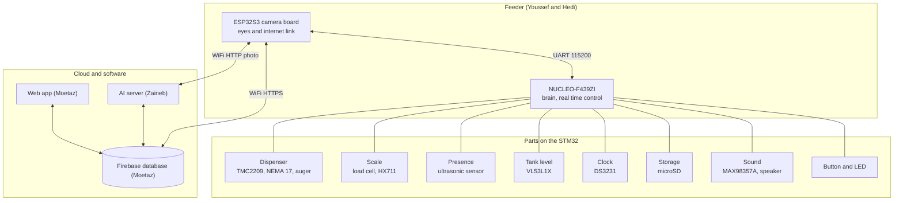
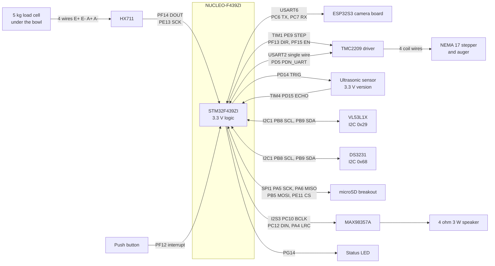
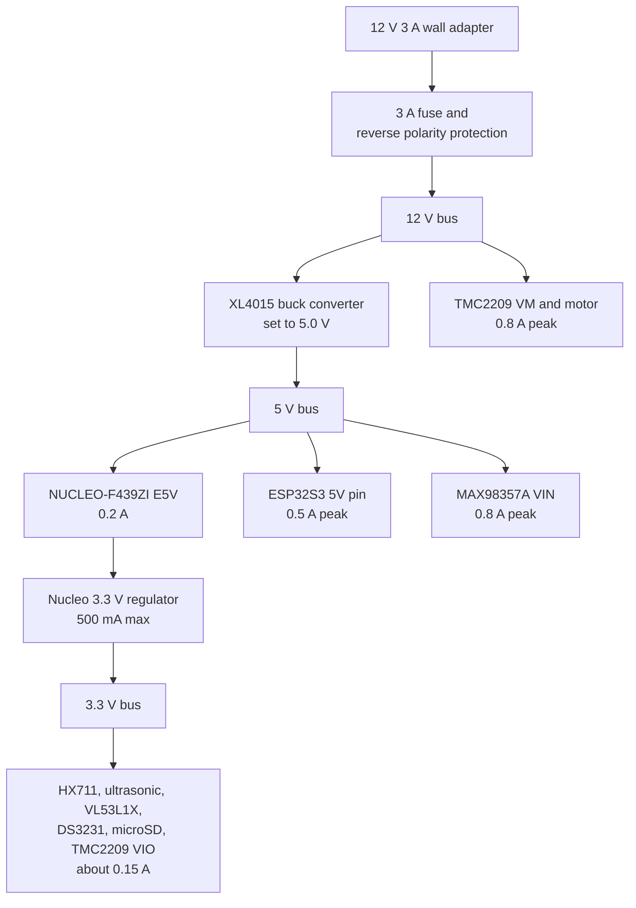
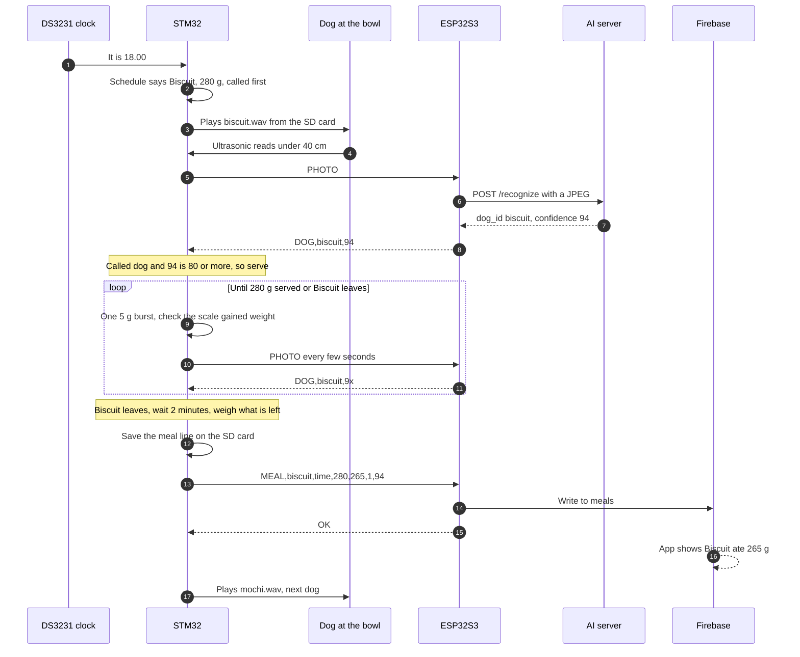
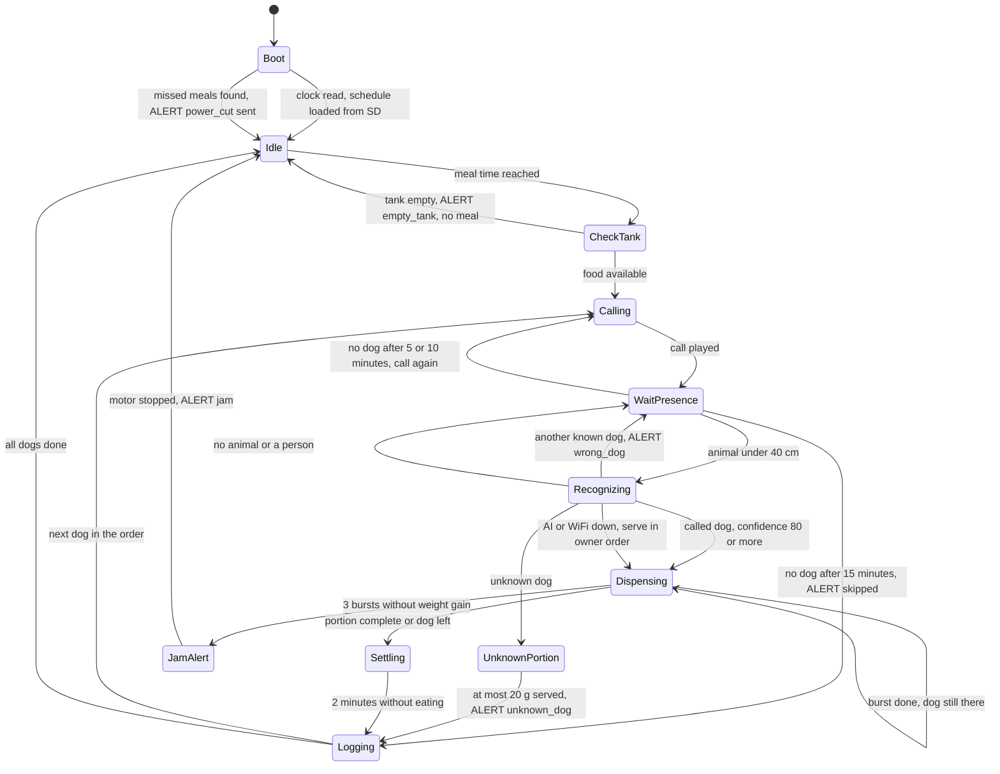
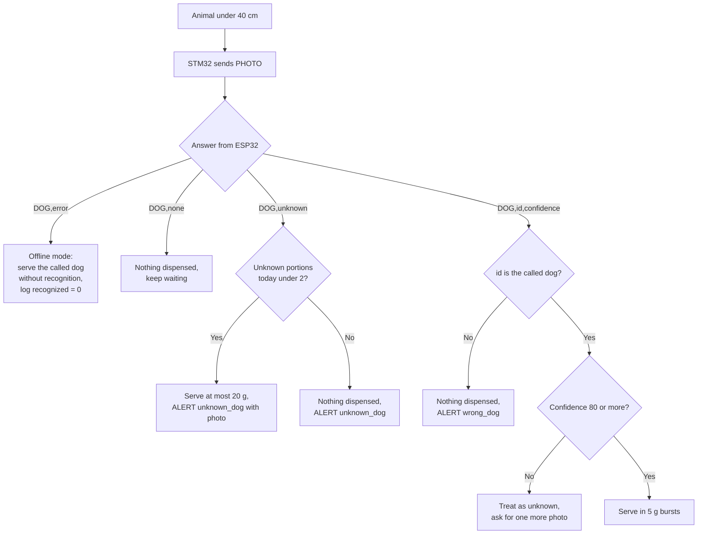
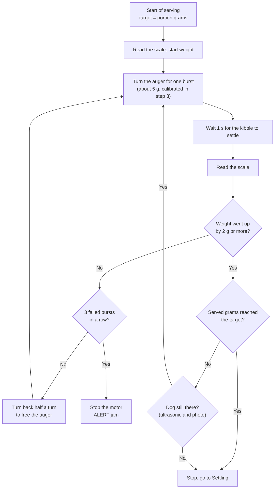
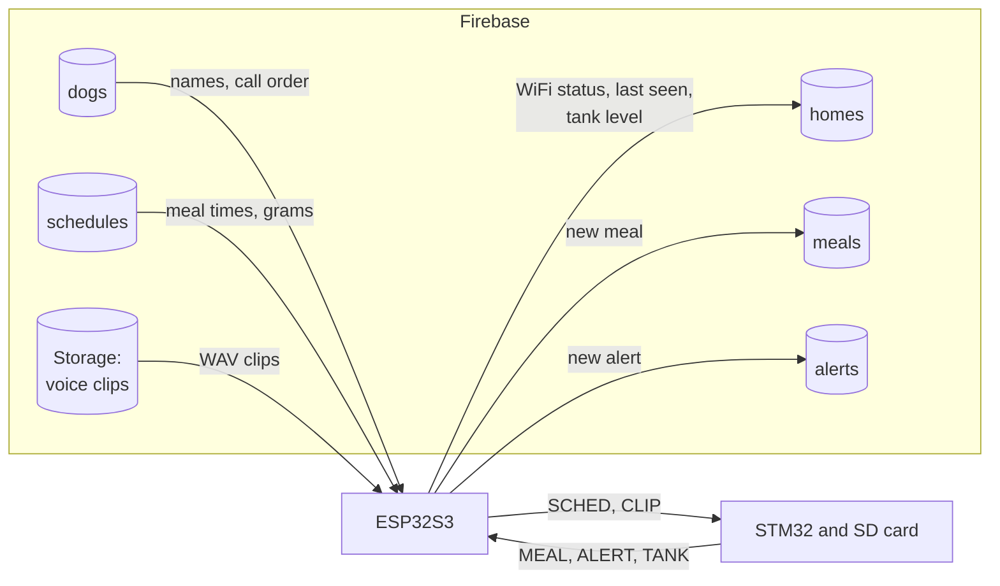
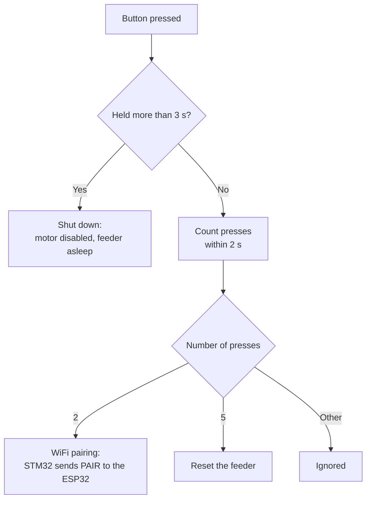

# Step 2: System architecture

How the parts from [step 1](01_hardware_list.md) fit together: which board does what, how they talk, how power flows, which pin each part uses, and how a meal runs from start to end.

## Contents

| # | Section | What it shows |
|---|---|---|
| 1 | [Overview](#1-overview) | The whole system in layers: cloud, boards, parts |
| 2 | [Who decides what](#2-who-decides-what) | The job of the STM32 and the job of the ESP32 |
| 3 | [Connection diagram](#3-connection-diagram) | Every part, its bus and its pins |
| 4 | [Communication links](#4-communication-links) | Bus types, speeds, addresses, UART messages |
| 5 | [Power](#5-power) | Power tree, voltages, currents, safety rules |
| 6 | [Pin plan](#6-pin-plan) | The exact pin for every wire |
| 7 | [One meal in time order](#7-one-meal-in-time-order) | Messages between STM32, ESP32, AI server and Firebase |
| 8 | [STM32 states](#8-stm32-states) | The feeder program as a state machine |
| 9 | [Decision at the bowl](#9-decision-at-the-bowl) | What happens for each AI answer |
| 10 | [Dispensing and jam check](#10-dispensing-and-jam-check) | How each 5 g burst is checked with the scale |
| 11 | [Failure handling](#11-failure-handling) | Jam, tank, WiFi, power cut |
| 12 | [Data with the database](#12-data-with-the-database) | What the feeder reads and writes in Firebase |
| 13 | [Button and LED](#13-button-and-led) | Press patterns and LED states |
| 14 | [Decisions to confirm](#14-decisions-to-confirm) | Open points for the team |

## 1. Overview

## 2. Who decides what

The STM32 is the **brain**: it runs the meal, owns the clock and the schedule copy, and keeps working when WiFi is down. The ESP32 is the **eyes and the internet link**: it only does what the STM32 asks and reports back.

| Decision or job | STM32 | ESP32 |
|---|---|---|
| Meal time (clock and schedule) | Yes | No |
| Playing the dog's call | Yes | No |
| Detecting an animal | Yes (ultrasonic) | No |
| Taking a photo and asking the AI server | No | Yes, when the STM32 asks |
| Deciding to dispense | Yes, from the AI answer | No |
| Motor, scale, tank level | Yes | No |
| Reading schedules and voice clips from Firebase | No | Yes, then sends them to the STM32 |
| Writing meals and alerts to Firebase | No | Yes, from messages sent by the STM32 |
| Offline logs | Yes (SD card) | No |
| WiFi pairing and status | No | Yes, reports the status to the STM32 |
| Correct time | Yes (DS3231) | Sends internet time once a day to correct it |

Why this split: if WiFi, the ESP32 or the AI server fails, the STM32 alone still feeds the dogs on time.

## 3. Connection diagram

Every arrow shows the bus and the STM32 pins it uses. Full pin table in [section 6](#6-pin-plan).

## 4. Communication links

| Link | Between | Type | Speed or setting |
|---|---|---|---|
| Feeder to cloud | ESP32 and Firebase | WiFi, HTTPS | |
| Recognition | ESP32 and AI server | WiFi, HTTP: JPEG photo in, dog id and confidence out | Answer within about 1 s |
| Boards | STM32 and ESP32 | UART, 3.3 V, text lines ending with a newline | 115200 baud, 8N1 |
| Motor driver settings | STM32 and TMC2209 | Single wire UART (current, microsteps, stall detection) | 115200 baud |
| Motor movement | STM32 and TMC2209 | STEP pulses from a timer, DIR and EN levels | 1/16 microsteps, 3200 steps per auger turn |
| Scale | STM32 and HX711 | 2 wire serial (clock and data) | 10 readings per second, gain 128 |
| Presence | STM32 and ultrasonic | TRIG pulse of 10 us, ECHO pulse timed by TIM4 | One reading every 100 ms |
| Sensors and clock | STM32, VL53L1X, DS3231 | I2C1 bus | 400 kHz |
| Storage | STM32 and microSD | SPI1 with FatFs | Up to 12 MHz |
| Sound | STM32 and MAX98357A | I2S3 with DMA | WAV, 16 kHz, 16 bit, mono |
| Debug | STM32 and computer | ST-LINK virtual serial port (USART3, PD8, PD9) | 115200 baud |

### I2C addresses

| Device | Address | Note |
|---|---|---|
| VL53L1X | 0x29 | Fixed at power on |
| DS3231 | 0x68 | Real time clock |
| AT24C32 EEPROM on the DS3231 module | 0x57 | Present on most modules, not used |

### UART messages between the boards

One message per line, readable as text, so we can watch and type them in a serial monitor while testing. Every message gets `OK` or `ERR` back, so a lost message is noticed and sent again. Final format is fixed in step 5.

| Direction | Message | Meaning |
|---|---|---|
| STM32 to ESP32 | `PHOTO` | An animal is in front of the bowl: take a photo and ask the AI server |
| ESP32 to STM32 | `DOG,biscuit,94` | AI answer: dog id and confidence in percent |
| ESP32 to STM32 | `DOG,unknown,0` | An animal that is not one of the home's dogs |
| ESP32 to STM32 | `DOG,none,0` | No animal, or a person |
| ESP32 to STM32 | `DOG,error,0` | AI server or WiFi unavailable |
| STM32 to ESP32 | `MEAL,biscuit,1730900000,280,265,1,94` | Meal log: dog, time, grams served, grams eaten, recognized, confidence |
| STM32 to ESP32 | `ALERT,jam` | Alert to write to Firebase (skipped, unknown_dog, wrong_dog, jam, low_tank, empty_tank, power_cut) |
| STM32 to ESP32 | `TANK,62` | Tank level in percent |
| ESP32 to STM32 | `SCHED,biscuit,1,08:00,280,18:00,280` | Schedule for one dog: id, call order, then time and grams for each meal |
| ESP32 to STM32 | `CLIP,biscuit,8000` | A voice clip of 8000 bytes follows, to save on the SD card |
| ESP32 to STM32 | `TIME,1730900000` | Internet time to correct the clock |
| ESP32 to STM32 | `WIFI,1` | WiFi status: 1 connected, 0 offline, 2 pairing |
| STM32 to ESP32 | `PAIR` | Button pressed twice: start WiFi pairing |
| Both | `OK`, `ERR` | Reply to every message |

## 5. Power

| Rail | Source | Loads | Peak current | Margin |
|---|---|---|---|---|
| 12 V | Adapter, 3 A | Motor driver, buck converter | About 1.6 A | Adapter gives 3 A |
| 5 V | XL4015, 5 A | Nucleo, ESP32, amplifier | About 1.5 A | Buck gives 5 A |
| 3.3 V | Nucleo regulator, 500 mA | Sensors, SD card, driver logic, STM32 | About 0.25 A | Half of the limit |

Rules:

1. **All grounds are connected together**: adapter, buck, Nucleo, ESP32, driver, amplifier. Without a common ground, UART and sensors give wrong values.
2. **Set the buck to 5.0 V with the multimeter before connecting anything** to it. A new XL4015 can come set to any voltage.
3. A 1000 uF capacitor and a 100 nF capacitor sit at the TMC2209 12 V input, and another pair at the ESP32 5 V pin.
4. The motor driver needs its 12 V before the motor moves, and the motor wires are **never** plugged or unplugged while the driver is powered (this destroys the TMC2209).
5. During development the Nucleo runs from USB. When it runs from the 5 V bus, set the power jumper to E5V (see the Nucleo user manual UM1974) and do not rely on USB power at the same time.
6. On most DS3231 modules a charging circuit is fitted for a rechargeable LIR2032 cell. With a normal CR2032, remove the charging resistor or diode on the module.

## 6. Pin plan

Pins chosen to avoid the ones already used on the board by Ethernet (PA1, PA2, PA7, PB13, PC1, PC4, PC5, PG11, PG13), USB (PA8 to PA12, PG6, PG7) and the ST-LINK serial port (PD8, PD9). **Check every pin in STM32CubeMX and the user manual UM1974 before wiring**; CubeMX shows conflicts in red.

### NUCLEO-F439ZI

| # | Part | Signal | STM32 pin | Header label | Peripheral | Direction |
|---|---|---|---|---|---|---|
| 1 | TMC2209 | STEP | PE9 | D6 | TIM1 channel 1, pulse output | Out |
| 2 | TMC2209 | DIR | PF13 | D7 | GPIO | Out |
| 3 | TMC2209 | EN (low enables the motor) | PF15 | D2 | GPIO | Out |
| 4 | TMC2209 | PDN_UART | PD5 | CN9 | USART2 TX, single wire mode, through 1 kohm | In and out |
| 5 | HX711 | DOUT | PF14 | D4 | GPIO | In |
| 6 | HX711 | SCK | PE13 | D3 | GPIO | Out |
| 7 | Ultrasonic | TRIG | PD14 | D10 | GPIO | Out |
| 8 | Ultrasonic | ECHO | PD15 | D9 | TIM4 channel 4, input capture | In |
| 9 | VL53L1X and DS3231 | SCL | PB8 | D15 | I2C1 | Out |
| 10 | VL53L1X and DS3231 | SDA | PB9 | D14 | I2C1 | In and out |
| 11 | microSD | SCK | PA5 | D13 | SPI1 | Out |
| 12 | microSD | MISO | PA6 | D12 | SPI1 | In |
| 13 | microSD | MOSI | PB5 | CN7 | SPI1 (PA7 avoided, used by Ethernet) | Out |
| 14 | microSD | CS | PE11 | D5 | GPIO | Out |
| 15 | MAX98357A | BCLK | PC10 | CN8 | I2S3 CK | Out |
| 16 | MAX98357A | DIN | PC12 | CN8 | I2S3 SD | Out |
| 17 | MAX98357A | LRC | PA4 | CN7 | I2S3 WS | Out |
| 18 | ESP32 | STM32 TX to ESP32 RX | PC6 | CN7 | USART6 TX | Out |
| 19 | ESP32 | STM32 RX from ESP32 TX | PC7 | CN7 | USART6 RX | In |
| 20 | Button | Input | PF12 | D8 | GPIO with interrupt, internal pull up | In |
| 21 | Status LED | Output | PG14 | D1 | GPIO, through 330 ohm | Out |

Built in parts kept for debugging: LD1 green (PB0), LD2 blue (PB7), LD3 red (PB14), user button (PC13), ST-LINK serial port (PD8, PD9) for printing logs to the computer.

### ESP32S3 (XIAO Sense)

| Signal | XIAO pin | Connects to |
|---|---|---|
| UART TX | D6 (GPIO43) | STM32 PC7 |
| UART RX | D7 (GPIO44) | STM32 PC6 |
| 5V | 5V | 5 V bus |
| GND | GND | Common ground |

The camera is built into the Sense board. USB C stays free for flashing and logs.

### TMC2209 module

| Driver pin | Connects to |
|---|---|
| VM | 12 V bus, with 1000 uF and 100 nF capacitors |
| GND (motor side and logic side) | Common ground |
| VIO | 3.3 V bus |
| STEP, DIR, EN | STM32 PE9, PF13, PF15 |
| PDN_UART | STM32 PD5 through 1 kohm |
| MS1, MS2 | GND (driver address 0) |
| A1, A2, B1, B2 | Motor coils (check the pairs with the multimeter) |

## 7. One meal in time order

Example: Biscuit eats at 18:00, then Mochi.

## 8. STM32 states

The main feeder program is one state machine. Each box is a state; each arrow is the event that changes it.

## 9. Decision at the bowl

## 10. Dispensing and jam check

The scale checks every burst, so a jam or an empty tank is noticed after a few grams.

Second jam check: the TMC2209 stall detection (StallGuard) flags a blocked motor even before the scale reading.

## 11. Failure handling

| Failure | How the feeder notices | What it does | Alert sent |
|---|---|---|---|
| Jam | 3 bursts in a row without weight gain, or TMC2209 stall flag | Turns back to free the auger, then stops the motor | `jam` |
| Low tank | VL53L1X distance above the low threshold | Keeps serving | `low_tank` |
| Empty tank | VL53L1X distance at the bottom, or bursts without weight | No meal | `empty_tank` (urgent) |
| WiFi or AI server down | `DOG,error` or no answer within 5 s | Serves meals in the owner's order without recognition; saves logs on the SD card | `offline`, sent when WiFi is back |
| Power cut | At boot, last meal time on the SD card is older than a scheduled meal | Does not serve missed meals automatically; lists them | `power_cut` with the number of missed meals |
| SD card missing or broken | FatFs mount fails at boot | Uses the last schedule kept in STM32 flash and plays a built in chime instead of voice clips | `offline` style alert with the reason |
| ESP32 not answering | No `OK` to 3 messages | Treats it like WiFi down; resets the ESP32 through its power or reset line in a later version | none until it is back |

## 12. Data with the database

The database is the only link between the feeder and the software. Field names follow `docs/SPEC.md` section 6 and are agreed with Moetaz.

| Collection | Feeder reads | Feeder writes | When |
|---|---|---|---|
| `homes/{homeId}` | | WiFi status, last seen, tank level | Every 5 minutes and on change |
| `dogs/{dogId}` | Name, call order, voice clip url | | When the app changes them |
| `schedules/{dogId}` | Up to 4 meals: time, grams | | When the app changes them |
| `meals/{mealId}` | | Dog, time, grams served, grams eaten, recognized, confidence | After each meal (later if offline) |
| `alerts/{alertId}` | | Type, time, message, photo url | When it happens (later if offline) |
| Storage | Voice clip files | Photo of an unknown dog | When a clip changes; on unknown dog |

## 13. Button and LED

| LED | Meaning |
|---|---|
| Solid | Connected to WiFi |
| Blinking | Pairing mode |
| Off | Offline |

## 14. Decisions to confirm

| # | Decision | Proposed | With |
|---|---|---|---|
| 1 | STM32 is the brain, ESP32 only camera and internet | Yes | Hedi |
| 2 | UART text messages at 115200 baud, every message answered with `OK` or `ERR` | Yes | Hedi |
| 3 | Presence distance that starts a photo | Under 40 cm | Hedi |
| 4 | Audio format on the SD card | WAV, 16 kHz, 16 bit, mono (the app converts recordings) | Moetaz |
| 5 | Firebase access from the ESP32 | Firestore REST API | Moetaz |
| 6 | AI endpoint | `POST /recognize` with a JPEG, answer `{"dog_id": "biscuit", "confidence": 94}` | Zaineb |
| 7 | Values from the spec | 80% confidence, 5 g bursts, calls at 0, 5 and 10 minutes, alert at 15, unknown dog 20 g twice a day | Team |
| 8 | Jam rule | 3 bursts in a row with less than 2 g gain | Hedi |
| 9 | Missed meals after a power cut | Not served automatically, the owner decides in the app | Team |
