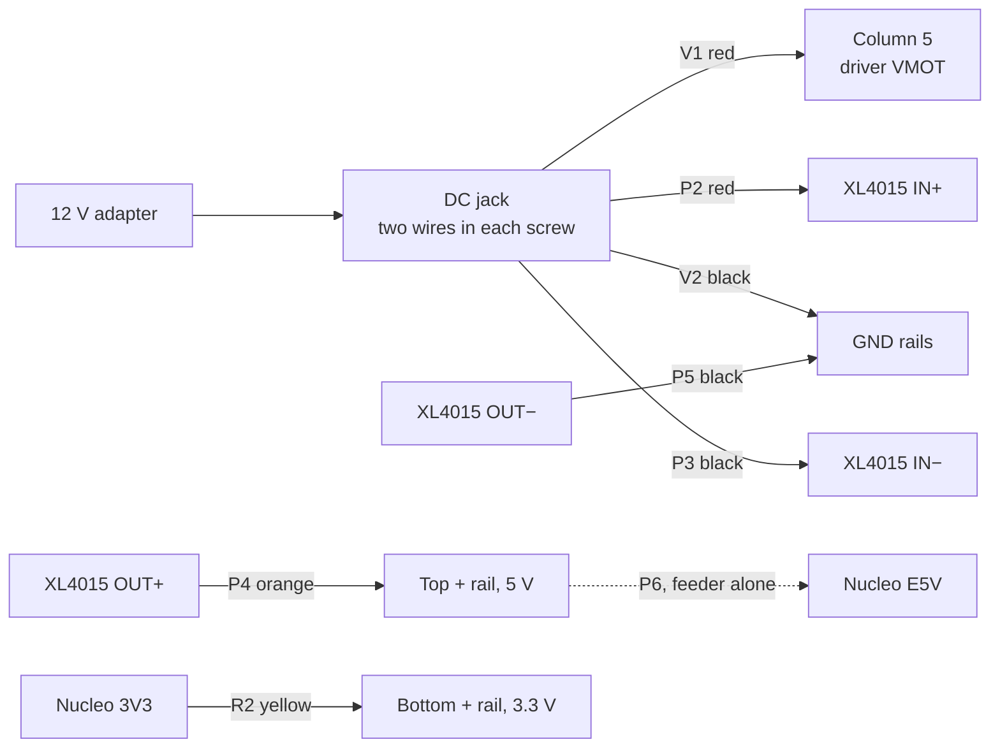
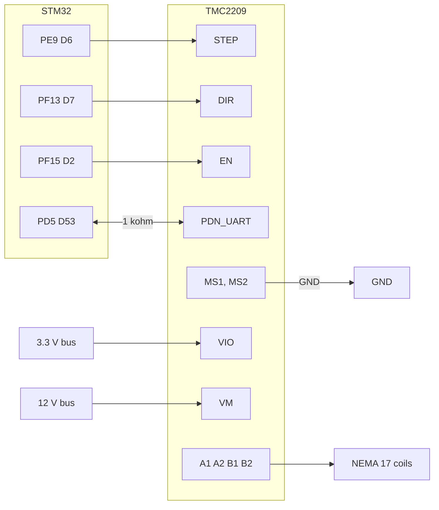
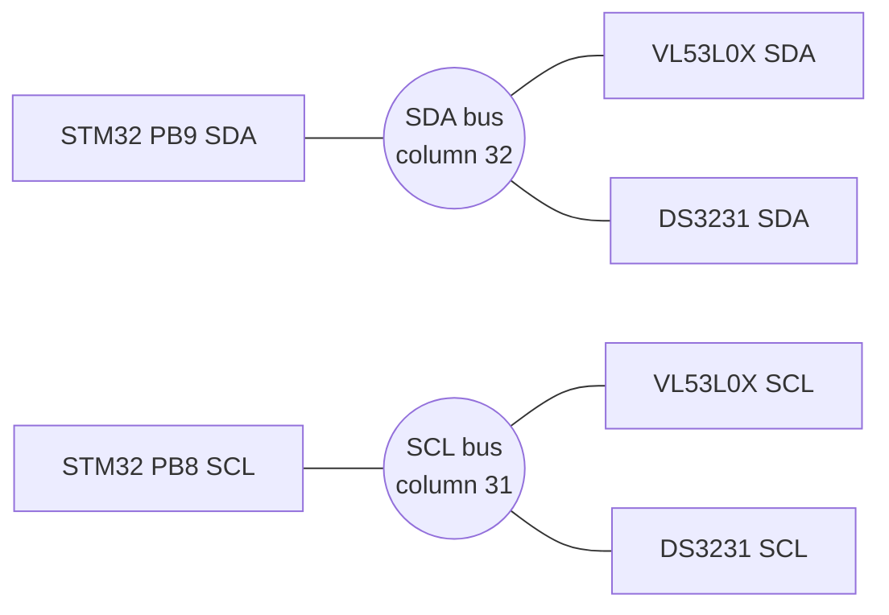

# Step 4: Wiring list

Every wire of the feeder, part by part: from which pin, to which pin, which colour, and what to measure before powering on. Pins follow the plan in [step 2, section 6](02_system_architecture.md#6-pin-plan). The whole feeder on one breadboard: [circuit 11, full circuit](circuits_by_part/11_full_circuit/README.md).

**Status: written before testing.** Each wire is checked during the component tests of step 3; tick the **Checked** column when a wire is confirmed on the real part, and correct the row if the real module differs.

## Contents

| # | Section |
|---|---|
| 1 | [Before you start](#1-before-you-start) |
| 2 | [Wire colours](#2-wire-colours) |
| 3 | [Nucleo header map](#3-nucleo-header-map) |
| 4 | [Power](#4-power) |
| 4B | [Breadboard rails and power entries](#4b-breadboard-rails-and-power-entries) |
| 5 | [ESP32-CAM camera board](#5-esp32-cam-camera-board) |
| 5B | [Flashing the ESP32-CAM with the DevKit](#5b-flashing-the-esp32-cam-with-the-devkit) |
| 6 | [TMC2209 driver and stepper motor](#6-tmc2209-driver-and-stepper-motor) |
| 6B | [DRV8825 driver and stepper motor (demo driver)](#6b-drv8825-driver-and-stepper-motor-demo-driver) |
| 7 | [Load cell and HX711](#7-load-cell-and-hx711) |
| 8 | [Ultrasonic sensor](#8-ultrasonic-sensor) |
| 9 | [I2C bus: VL53L0X and DS3231](#9-i2c-bus-vl53l0x-and-ds3231) |
| 10 | [microSD card](#10-microsd-card) |
| 11 | [MAX98357A and speaker](#11-max98357a-and-speaker) |
| 12 | [Button and LED](#12-button-and-led) |
| 13 | [Totals per rail](#13-totals-per-rail) |
| 14 | [STM32CubeMX settings](#14-stm32cubemx-settings) |
| 15 | [Checklist before powering on](#15-checklist-before-powering-on) |

## 1. Before you start

1. **Labels on your modules can differ** from the names here (for example `DT` or `DOUT` on the HX711). Match by function, and write the label of your module in the Note column.
2. **The Nucleo header numbers** come from the NUCLEO-F439ZI user manual UM1974. Check each pin against the pinout figure of UM1974 and the STM32CubeMX pin view before the first connection.
3. **Wire with everything unplugged.** Power only after the checklist in section 15.
4. **Change one thing at a time**, then test.

## 2. Wire colours

Same colours on every part, so a wrong wire is visible at a glance.

| Colour | Use |
|---|---|
| Red | 12 V |
| Orange | 5 V |
| Yellow | 3.3 V |
| Black | GND |
| Blue | I2C SDA |
| White | I2C SCL |
| Green | UART: green from the ESP32-CAM TX, light green from the STM32 TX |
| Purple | SPI and I2S (shades of purple; pink for the SD card CS) |
| Grey or brown | Other signals (STEP, DIR, EN, TRIG, ECHO, button, LED) |

Wire size: 22 AWG or thicker for 12 V, 5 V, GND and motor coils. Standard jumper wires for signals.

## 3. Nucleo header map

Only the pins this project uses. Header names follow UM1974: **CN7, CN8, CN9, CN10** are the inner (Arduino style) headers, **CN11 and CN12** the long outer (morpho) headers.

| STM32 pin | Header and label | Used for |
|---|---|---|
| PE9 | CN10, D6 | Driver STEP |
| PF13 | CN10, D7 | Driver DIR |
| PF15 | CN10, D2 | Driver EN |
| PD5 | CN9, D53 | TMC2209 PDN_UART (only if a TMC2209 is lent; not used with the DRV8825) |
| PF14 | CN10, D4 | HX711 DOUT |
| PE13 | CN10, D3 | HX711 SCK |
| PD14 | CN7, D10 | Ultrasonic TRIG |
| PD15 | CN7, D9 | Ultrasonic ECHO |
| PB8 | CN7, D15 | I2C SCL |
| PB9 | CN7, D14 | I2C SDA |
| PA5 | CN7, D13 | SPI SCK |
| PA6 | CN7, D12 | SPI MISO |
| PB5 | CN7, D22 | SPI MOSI |
| PE11 | CN10, D5 | SD card CS |
| PC10 | CN8, D45 | I2S BCLK |
| PC12 | CN8, D47 | I2S DIN |
| PA4 | CN7, D24 | I2S LRC |
| PC6 | CN7, D16 | UART TX to ESP32 |
| PC7 | CN7, D21 | UART RX from ESP32 |
| PF12 | CN7, D8 | Button |
| PG14 | CN10, D1 | Status LED |
| 3V3 | CN8, 3V3 | 3.3 V output |
| 5V | CN8, 5V | 5 V (see power section) |
| GND | CN8, GND (several GND pins on every header) | Ground |
| E5V | CN11, E5V | External 5 V input |

## 4. Power

Drawn in [circuit 7](circuits_by_part/07_power/README.md). One 12 V adapter feeds everything: 12 V for the driver in column 5, the XL4015 makes the 5 V of the top + rail, the Nucleo makes the 3.3 V of the bottom + rail.

| # | From | To | Colour | Measure or note | Checked |
|---|---|---|---|---|---|
| P1 | 12 V adapter | DC jack | | Centre pin + on the adapter label; plug in last | |
| P2 | DC jack `+` screw | XL4015 `IN+` | Red | Same screw as V1; twist the two wire ends together | |
| P3 | DC jack `−` screw | XL4015 `IN−` | Black | Same screw as V2 | |
| P4 | XL4015 `OUT+` | Top + rail (5 V), column 13 | Orange | **Only after OUT reads 5.0 V** (4.95 to 5.10 V) with nothing connected | |
| P5 | XL4015 `OUT−` | Top − rail (GND), column 12 | Black | | |
| P6 | Top + rail (5 V), column 2 | Nucleo `E5V` (CN11 pin 6) | Orange | Feeder alone only, with the power jumper JP3 on E5V; same hole as R1, which is out | |

Also: V1 to V3 from section 6B (12 V to column 5 and its capacitor), R2 to R4 from section 4B. **R1 is removed for good**: the XL4015 now feeds the top + rail, and two 5 V sources must never meet.

Why two wires in each jack screw: a breadboard contact is made for about 1 A. Taking the XL4015 input at the jack, and not from column 5, keeps the motor current (0.8 A) and the XL4015 current (about 0.8 A) on separate contacts.

| | Tests (laptop next to the feeder) | Feeder alone |
|---|---|---|
| Nucleo power | USB, JP3 on U5V | P6 and JP3 on E5V |
| Power on | USB, then the adapter | Adapter; USB only after it, for logs |
| Power off | Adapter, then the USB | USB, then the adapter |

No fuse or reverse polarity protection is fitted. Before the first plug in, check that the adapter label shows the centre pin as +, and never let the 12 V touch a rail or a board pin.

## 4B. Breadboard rails and power entries

Used by every circuit of [circuits_by_part](circuits_by_part/README.md). One 830 point breadboard (63 columns); every part fits in columns 1 to 49, so a 60 column board works too. Each rail hole takes one wire: section 13 lists the rail column of every wire.

| Rail | Use |
|---|---|
| Top + | **5 V** (amplifier, HC-SR04, ESP32-CAM, microSD) |
| Top − | GND |
| Bottom − | GND |
| Bottom + | **3.3 V** (HX711, clock, tank sensor, driver logic) |
| 12 V | **On no rail.** Only in column 5, top half (the driver VMOT column), framed in red in the pictures |

Checked on the team's board (10 November 2026): 830 points, 63 columns, and the rails run along the whole length, so no bridge wires are needed. On another board whose rails are cut in the middle (a break in the red and blue lines), bridge each of the 4 rails across the cut with a short wire of the same colour.

| # | From | To | Colour | Note | Checked |
|---|---|---|---|---|---|
| R1 | Nucleo 5V (CN8 pin 9) | Top + rail (5 V), column 2 | Orange | Tests before circuit 7 only. Removed for good in circuit 7, where the XL4015 feeds the rail | |
| R2 | Nucleo 3V3 (CN8 pin 7) | Bottom + rail (3.3 V), column 2 | Yellow | | |
| R3 | Nucleo GND (CN10 pin 5) | Bottom − rail (GND), column 3 | Black | | |
| R4 | Top − rail | Bottom − rail, column 1 | Black | Joins both GND rails | |

## 5. ESP32-CAM camera board

Drawn in [circuit 5](circuits_by_part/05_esp32_cam_link/README.md). The ESP32-CAM sits **outside the board**, camera facing the bowl, joined by 4 female to male wires that all come from the same pin row (5V, GND, IO12, IO13, IO15, IO14, IO2, IO4). Match the wires by the printed names: from the other side of the board the row reads in the opposite order.

| # | From | To | Colour | Measure or note | Checked |
|---|---|---|---|---|---|
| E1 | ESP32-CAM `5V` | Top + rail (5 V), column 37 | Orange | Not the 3V3 or VCC pin: on 3.3 V the board restarts when WiFi starts | |
| E2 | ESP32-CAM `GND` (next to 5V) | Top − rail (GND), column 36 | Black | | |
| E3 | ESP32-CAM `IO15` (TX in code) | Column 33, row j | Green | | |
| E4 | ESP32-CAM `IO14` (RX in code) | Column 32, row j | Light green | | |
| E5 | 470 uF capacitor | Column 38: long leg (+) in the top + rail, short leg in the top − rail | | Stripe side is the short leg. Stops restarts on WiFi current peaks | |
| E6 | 1 kohm resistor | Column 29, row i, to column 32, row i, lying flat | | Bands brown, black, red. Protects both pins | |
| E7 | Column 33 (row g) | Nucleo D21 · PC7 (CN7 pin 11) | Green | ESP32-CAM TX to STM32 RX | |
| E8 | Column 29 (row h) | Nucleo D16 · PC6 (CN7 pin 1) | Light green | STM32 TX to ESP32-CAM RX, through E6 | |
| E9 | ESP32-CAM `U0T`, `U0R`, `IO0` | Not connected | | They load programs with the DevKit (circuit 6) | |

Also needed: R1, R3 and R4 from section 4B.

1. IO15 and IO14 are free because the ESP32-CAM microSD slot is not used: **keep that slot empty**.
2. U0T and U0R stay free for loading programs; IO12 must stay low at start up or the board does not boot.
3. The 100 nF capacitor of the first plan is left out: the ESP32-CAM already has small capacitors next to its chips, and the 470 uF gives the big reserve it lacks.

If the XIAO ESP32S3 Sense is ever used instead: `5V` and `GND` as E1 and E2, `D6` (GPIO43, TX) in place of IO15 and `D7` (GPIO44, RX) in place of IO14; everything else stays the same.

## 5B. Flashing the ESP32-CAM with the DevKit

Drawn in [circuit 6](circuits_by_part/06_esp32_cam_flashing/README.md). Loads programs into the ESP32-CAM, which has no USB port, through the USB chip of the ESP32 DevKit V1. On the table, with female to female wires; no breadboard needed.

| # | From | To | Colour | Measure or note | Checked |
|---|---|---|---|---|---|
| F1 | DevKit `EN` | DevKit `GND` (left row) | Grey | Holds the DevKit chip off | |
| F2 | DevKit `VIN` | ESP32-CAM `5V` | Orange | On the table only; leave it out when the ESP32-CAM is wired to the feeder | |
| F3 | DevKit `GND` (right row) | ESP32-CAM `GND` (next to 5V) | Black | ESP32-CAM wired to the feeder: to the top − rail, column 39, instead | |
| F4 | DevKit `TX0` | ESP32-CAM `U0T` | Green | TX to TX is right here: the DevKit pins are named for its own chip | |
| F5 | DevKit `RX0` | ESP32-CAM `U0R` | Light green | | |
| F6 | ESP32-CAM `IO0` | ESP32-CAM `GND` (next to IO0) | Grey | Only while loading; remove it and press RST to run the program | |
| F7 | DevKit micro USB | Laptop | USB cable | Plug in last; with the feeder, after the Nucleo USB | |

Settings for PlatformIO: `board = esp32cam`, `upload_speed = 115200`, `monitor_speed = 115200`.

## 6. TMC2209 driver and stepper motor

**Only if the ISS group lends a TMC2209.** The demo uses the DRV8825 of [section 6B](#6b-drv8825-driver-and-stepper-motor-demo-driver), drawn in circuit 1.

Pin names below are for the BigTreeTech and FYSETC modules. Some modules have separate `RX` and `TX` pins that are both the same `PDN_UART` line; use one of them.

| # | TMC2209 pin | To | Colour | Measure or note | Checked |
|---|---|---|---|---|---|
| M1 | `VM` | 12 V bus | Red | 12 V | |
| M2 | `GND` (power side, next to VM) | GND bus | Black | | |
| M3 | 470 uF and 100 nF capacitors | Between `VM` and `GND`, at the driver | | Long leg (+) on VM | |
| M4 | `VIO` (also marked `VDD`) | 3.3 V bus | Yellow | 3.3 V | |
| M5 | `GND` (logic side, next to VIO) | GND rail | Black | | |
| M6 | `STEP` | STM32 PE9 (CN10, D6) | Grey | | |
| M7 | `DIR` | STM32 PF13 (CN10, D7) | Grey | | |
| M8 | `EN` | STM32 PF15 (CN10, D2) | Grey | Low = motor on, high = motor off | |
| M9 | 10 kohm resistor | Between `EN` and 3.3 V | | Keeps the motor off while the STM32 resets | |
| M10 | `PDN_UART` | 1 kohm resistor, then STM32 PD5 (CN9, D53) | Green | | |
| M11 | `MS1` | GND | Black | Driver UART address 0 | |
| M12 | `MS2` | GND | Black | Driver UART address 0 | |
| M13 | `CLK` (if present) | GND | Black | Uses the internal clock | |
| M14 | `A1`, `A2` (also `1A`, `1B`) | Motor coil A, both wires | | Find the pairs first (below) | |
| M15 | `B1`, `B2` (also `2A`, `2B`) | Motor coil B, both wires | | | |
| M16 | `VREF` potentiometer | | | Set to about 1.1 V for 0.8 A as a safe start; check the formula on the module page | |

How to find the coil pairs: with the motor unplugged, measure the resistance between wires. Two wires with **1 to 5 ohm** between them are one coil. Wires of different coils show no connection. If the motor only shakes, the pairs are mixed: each pair must go on one coil output. Swapping the two wires inside one coil only reverses the direction.

**Never plug or unplug the motor while the driver has 12 V.** This destroys the TMC2209.

## 6B. DRV8825 driver and stepper motor (demo driver)

The driver for the demo: a DRV8825, sold locally. Section 6 is kept for a TMC2209, if the ISS group lends one. Drawn in [circuit 1](circuits_by_part/01_stepper_motor_drv8825/README.md).

Breadboard layout: the DRV8825 straddles the middle gap in **columns 5 to 12**, turned so that **VMOT is top left (column 5, row f) and EN is bottom left (column 5, row e)**. Top half: power and motor. Bottom half: control. **12 V lives only in column 5, top half**; the rails are 5 V (top) and 3.3 V (bottom), see section 4B.

| Driver pin | Column | Row | Driver pin | Column | Row |
|---|---|---|---|---|---|
| VMOT | 5 | f | EN | 5 | e |
| GND | 6 | f | M0 | 6 | e |
| B2 | 7 | f | M1 | 7 | e |
| B1 | 8 | f | M2 | 8 | e |
| A1 | 9 | f | RST | 9 | e |
| A2 | 10 | f | SLP | 10 | e |
| FLT | 11 | f | STEP | 11 | e |
| GND | 12 | f | DIR | 12 | e |

| # | From | To | Colour | Note | Checked |
|---|---|---|---|---|---|
| V1 | DC jack `+` | Column 5, top half, row g (12 V) | Red | Never on a rail | |
| V2 | DC jack `−` | Top − rail (GND), column 3 | Black | | |
| V3 | 470 uF capacitor | Long leg (+) in column 5, row j; short leg in the top − rail, column 4 | | Stripe side is the short leg | |
| V4 | VMOT (column 5) | No wire | | Gets 12 V through column 5 | |
| V5 | GND (column 6) | Top − rail (GND), column 6 | Black | From row j | |
| V6 | GND (column 12, above DIR) | No wire | | Linked to the other GND inside the board | |
| V7 | A2 (column 10) | Motor green | Green (motor cable) | Row j; coil A | |
| V8 | A1 (column 9) | Motor black | Black (motor cable) | Row i; coil A | |
| V9 | B1 (column 8) | Motor red | Red (motor cable) | Row h; coil B | |
| V10 | B2 (column 7) | Motor blue | Blue (motor cable) | Row g; coil B | |
| V11 | FLT (column 11) | No wire | | Fault output, not used | |
| V12 | EN (column 5) | Nucleo D2 · PF15 (CN10 pin 12) | Blue grey | Row b. Low = motor on | |
| V13 | 10 kohm resistor | Column 5 row a to bottom + rail (3.3 V) | | Keeps the motor off while the STM32 resets | |
| V14 | M0, M1 (columns 6, 7) | No wire | | Pulled to 0 inside the driver | |
| V15 | M2 (column 8) | Bottom + rail (3.3 V) | Yellow | Row a. With M0 = M1 = 0: 1/16 step, 3200 steps per turn | |
| V16 | RST (column 9) | Bottom + rail (3.3 V) | Yellow | Row a. High = driver running | |
| V17 | SLP (column 10) | Bottom + rail (3.3 V) | Yellow | Row a. High = driver awake | |
| V18 | STEP (column 11) | Nucleo D6 · PE9 (CN10 pin 4) | Grey | Row c | |
| V19 | DIR (column 12) | Nucleo D7 · PF13 (CN10 pin 2) | Brown | Row d | |

Also needed: R2, R3 and R4 from section 4B.

Current limit: the DRV8825 gives a current of 2 x Vref. Measure Vref between the potentiometer and GND with 12 V on, and set it to **about 0.5 V (1 A)**. Without a multimeter: turn the potentiometer to the lowest current (usually fully anticlockwise), run the motor, then turn it up in small steps until the motor turns without skipping, and stop there.

Differences from the TMC2209 wiring of section 6:

1. No UART wire: PD5 is not used and USART2 is not needed in CubeMX.
2. Microsteps are set by wires (M0, M1, M2), not in software.
3. No stall detection: the scale is the only jam check.
4. Nucleo pin numbers (CN10 pin 2, 4, 5, 12 and CN8 pin 7) come from the user manual UM1974: check them on the board before plugging.

## 7. Load cell and HX711

Drawn in [circuit 2](circuits_by_part/02_load_cell_hx711/README.md). The team's HX711 board (checked on 24 November 2026): 4 pin side **VCC, DAT, CLK, GND**, the reverse of the generic green board (GND, DT, SCK, VCC), and 6 pin side (E+, E−, A−, A+, B−, B+). The 4 pin side plugs into **row a, columns 15 to 18** of the bottom half, **VCC in column 15 and GND in column 18**; DAT and CLK keep columns 16 and 17, so only the two power wires moved. The board hangs over the bottom edge.

| # | From | To | Colour | Measure or note | Checked |
|---|---|---|---|---|---|
| H1 | Load cell red | HX711 `E+` | Red (cell wire) | Colours vary by brand; see below | |
| H2 | Load cell black | HX711 `E-` | Black (cell wire) | | |
| H3 | Load cell white | HX711 `A-` | White (cell wire) | | |
| H4 | Load cell green | HX711 `A+` | Green (cell wire) | | |
| H5 | HX711 `B+`, `B-` | Not connected | | Channel B is not used | |
| H6 | HX711 `VCC` (column 15) | Bottom + rail (3.3 V), column 14 | Yellow | From row b. 3.3 V keeps DAT safe for the STM32. Never 5 V | |
| H7 | HX711 `GND` (column 18) | Bottom − rail (GND), column 20 | Black | From row b | |
| H8 | HX711 `DAT` (also `DT` or `DOUT`) (column 16) | Nucleo D4 · PF14 (CN10 pin 8) | Brown | Row d | |
| H9 | HX711 `CLK` (also `SCK`) (column 17) | Nucleo D3 · PE13 (CN10 pin 10) | Grey | Row c | |
| H10 | HX711 `VDD` (SparkFun board only) | 3.3 V rail | Yellow | Must equal VCC; generic boards do not have it | |

Also needed: R2 and R3 from section 4B.

The `RATE` pin (10 or 80 readings per second) is fixed on most generic boards at 10 per second, which gives less noise.

Checking the load cell colours: with the cell unplugged, the pair with the **highest** resistance (about 1 kohm) is the excitation pair (E+ and E minus); the other pair is the signal (A+ and A minus). If the weight reads negative, swap A+ and A minus.

Mounting: the arrow on the bar must point down, one end fixed to the base, the other end holding the bowl plate, with nothing else touching the plate.

## 8. Ultrasonic sensor

Drawn in [circuit 3](circuits_by_part/03_ultrasonic_hc_sr04/README.md). Standard 5 V HC-SR04 (the 3.3 V versions are not sold locally), so **Echo goes through a voltage divider**. The sensor sits **outside the board**, facing the dog, joined by 4 female to male wires: power to the top rails, Trig and Echo to **columns 25 and 26**.

| # | From | To | Colour | Measure or note | Checked |
|---|---|---|---|---|---|
| U1 | Sensor `VCC` | Top + rail (5 V), column 24 | Orange | | |
| U2 | Sensor `Trig` | Column 25, row j | Grey | | |
| U3 | Sensor `Echo` | Column 26, row j | Blue grey | 5 V signal: goes only to the divider | |
| U4 | Sensor `Gnd` | Top − rail (GND), column 27 | Black | | |
| U5 | 1 kohm resistor | Column 26 top half (row f) to column 26 bottom half (row e), across the middle gap | | Bands brown, black, red | |
| U6 | 2 kohm resistor | Column 26 bottom half (row a) to bottom − rail (GND) | | Bands red, black, red | |
| U7 | Column 25 (row h) | Nucleo D10 · PD14 (CN7 pin 16) | Grey | No resistor needed | |
| U8 | Column 26 bottom half (row c), middle of the divider | Nucleo D9 · PD15 (CN7 pin 18) | Brown | Must read 3.3 V high, never 5 V | |

Also needed: R1, R3 and R4 from section 4B.

The divider gives 5 V × 2 ÷ 3 = 3.3 V on PD15. Never connect Echo straight to the Nucleo.

## 9. I2C bus: VL53L0X and DS3231

Drawn in [circuit 8](circuits_by_part/08_i2c_clock_tank/README.md). Both parts share the same two wires: on the breadboard **column 31 (bottom half) is the SCL bus and column 32 the SDA bus**, and every SCL or SDA wire goes into one of them. The DS3231 board (ZS-042) plugs into row a, columns 29 to 34 (32K, SQW, SCL, SDA, VCC, GND), over the bottom edge; the VL53L0X sits in the tank lid, joined by 4 female to male wires. The clock board has pull up resistors on SDA and SCL, so none are added.

| # | From | To | Colour | Measure or note | Checked |
|---|---|---|---|---|---|
| I1 | Nucleo D15 · PB8 (CN7 pin 2) | Column 31, row d (SCL bus) | White | | |
| I2 | Nucleo D14 · PB9 (CN7 pin 4) | Column 32, row e (SDA bus) | Blue | | |
| I3 | VL53L0X `VIN` | Bottom + rail (3.3 V), column 24 | Yellow | | |
| I4 | VL53L0X `GND` | Bottom − rail (GND), column 25 | Black | | |
| I5 | VL53L0X `SDA` | Column 32, row b | Blue | | |
| I6 | VL53L0X `SCL` | Column 31, row c | White | | |
| I7 | VL53L0X `XSHUT` | No pin on the team's 4 pin board | | Tied inside the module; sensor always on | |
| I8 | VL53L0X `GPIO1` | No pin on the team's 4 pin board | | Interrupt not used | |
| I9 | DS3231 `VCC` (column 33) | Bottom + rail (3.3 V), column 36 | Yellow | From row c | |
| I10 | DS3231 `GND` (column 34) | Bottom − rail (GND), column 35 | Black | From row b | |
| I11 | DS3231 `SDA` | Column 32, row a | | Its own pin, in the SDA bus column; no wire | |
| I12 | DS3231 `SCL` | Column 31, row a | | Its own pin, in the SCL bus column; no wire | |
| I13 | DS3231 `SQW`, `32K` (columns 30, 29) | Not connected | | Not used | |
| I14 | CR2032 coin cell | DS3231 holder | | Safe as it is at 3.3 V; remove the 200 ohm charging resistor (marked 201) only if the board ever runs on 5 V | |
| I15 | Pull up check | | | With power on and nothing talking: SDA and SCL both read 3.3 V | |

Also needed: R2 and R3 from section 4B. VL53L0X: peel off the protective film on its window before testing.

If no part answers and both lines read 0 V, a module has no pull up resistors: add 4.7 kohm from SDA to 3.3 V and from SCL to 3.3 V.

## 10. microSD card

Drawn in [circuit 9](circuits_by_part/09_microsd_card/README.md). A 6 pin SPI module with its own 3.3 V regulator. Its pins plug into **row j, columns 42 to 47** (CS, SCK, MOSI, MISO, VCC, GND), with the card slot over the top edge; the board covers the top rail holes of columns 40 to 49. Check the pin order printed on your module.

| # | From | To | Colour | Measure or note | Checked |
|---|---|---|---|---|---|
| S1 | Module `VCC` (column 46) | Top + rail (5 V), column 52 | Orange | From row h. The module makes the 3.3 V of the card itself | |
| S2 | Module `GND` (column 47) | Top − rail (GND), column 51 | Black | From row i | |
| S3 | Module `SCK` (column 43) | Nucleo D13 · PA5 (CN7 pin 10) | Purple | Row g | |
| S4 | Module `MISO` (column 45) | Nucleo D12 · PA6 (CN7 pin 12) | Light purple | Row i | |
| S5 | Module `MOSI` (column 44) | Nucleo D22 · PB5 (CN7 pin 13) | Dark purple | Row h | |
| S6 | Module `CS` (column 42) | Nucleo D5 · PE11 (CN10 pin 6) | Pink | Row f | |

Also needed: R3 and R4 from section 4B, and the 5 V on the top + rail (R1 for a test on USB alone, or the XL4015 of section 4).

Card: 8 to 32 GB from a known brand, formatted as FAT32 on the computer before first use. Insert or remove it only with the power off.

## 11. MAX98357A and speaker

Drawn in [circuit 4](circuits_by_part/04_sound_max98357a/README.md). The 7 pins plug into **row j, columns 15 to 21** of the top half (LRC, BCLK, DIN, GAIN, SD, GND, Vin); the board stands over the top edge. 5 V and GND come straight from the top rails.

| # | From | To | Colour | Measure or note | Checked |
|---|---|---|---|---|---|
| A1 | `Vin` (column 21) | Top + rail (5 V), column 23 | Orange | From row h | |
| A2 | `GND` (column 20) | Top − rail (GND), column 22 | Black | From row i | |
| A3 | `BCLK` (column 16) | Nucleo PC10 · D45 (CN8 pin 6) | Purple | Row i | |
| A4 | `DIN` (column 17) | Nucleo PC12 · D47 (CN8 pin 10) | Dark purple | Row h | |
| A5 | `LRC` (column 15) | Nucleo PA4 · D24 (CN7 pin 17) | Light purple | Row g | |
| A6 | `GAIN` (column 18) | Not connected | | 9 dB; connect to GND for 12 dB if too quiet | |
| A7 | `SD` (column 19) | Not connected | | Plays a mono mix of left and right | |
| A8 | Speaker `+` | Breakout output `+` (screw terminal) | Red (speaker wire) | | |
| A9 | Speaker `minus` | Breakout output `minus` (screw terminal) | Black (speaker wire) | **Never connect a speaker wire to GND**; both outputs carry signal | |

Also needed: R1, R3 and R4 from section 4B. On USB power (R1) keep the volume low; full volume needs the 5 V supply of circuit 7.

## 12. Button and LED

Drawn in [circuit 10](circuits_by_part/10_button_led/README.md). Bottom half, columns 44 to 49; the button (12 mm, panel mount) sits on the feeder body with 2 soldered wires. No 3.3 V wire is needed: the button uses the STM32 internal pull up and the LED is driven by a pin.

| # | From | To | Colour | Measure or note | Checked |
|---|---|---|---|---|---|
| B1 | Button terminal 1 | Column 49, row c | Grey | No polarity: either terminal | |
| B2 | Button terminal 2 | Bottom − rail (GND), column 52 | Black | Pressed = 0 V on PF12 | |
| B3 | No capacitor | | | Removed on 24 November 2026: the code ignores presses closer than about 50 ms | |
| B4 | Column 49, row e | Nucleo D8 · PF12 (CN7 pin 20) | Grey | Internal pull up in the STM32: free = 3.3 V | |
| L1 | Column 44, row d | Nucleo D1 · PG14 (CN10 pin 14) | Brown | High = LED on | |
| L2 | 330 ohm resistor | Column 44 row c to column 47 row c, lying flat | | Bands orange, orange, brown | |
| L3 | LED | Long leg (+) in column 47 row a, short leg in the bottom − rail, column 47 | | Short leg = flat side of the rim; about 4 mA | |

Also needed: R3 from section 4B. To test before the button is soldered, touch the B1 and B2 wire ends together: that is a press.

**Never put the 100 uF spare capacitor on the button.** With the internal pull up (about 40 kohm) it would slow every press to about 4 s and break the long press and the press counts.

## 13. Totals per rail

For the breadboard plan of section 4B. Each rail hole takes one wire, so every wire below has its own rail column (in brackets). Every circuit is drawn. The microSD board covers the top rail holes of columns 40 to 49: keep them free.

| Rail or point | Wires (rail column) |
|---|---|
| Top + (5 V) | R1 (2, before circuit 7 only) or P6 (2, feeder alone), P4 (13), A1 (23), U1 (24), E1 (37), E5 long leg (38), S1 (52) |
| Top − (GND) | R4 (1), V2 (3), V3 short leg (4), V5 (6), P5 (12), A2 (22), U4 (27), E2 (36), E5 short leg (38), F3 (39, only while loading a program with the ESP32-CAM on the feeder), S2 (51) |
| Bottom + (3.3 V) | R2 (2), V13 (5), V15 (8), V16 (9), V17 (10), H6 (20), I3 (24), I9 (36) |
| Bottom − (GND) | R4 (1), R3 (3), H7 (14), I4 (25), U6 (26), I10 (35), L3 short leg (47), B3 (49), B2 (52) |
| Column 5, top half (12 V) | V1, V3 long leg, driver VMOT |

## 14. STM32CubeMX settings

Settings for each pin when creating the project in STM32CubeIDE.

### System

| Setting | Value |
|---|---|
| Board | NUCLEO-F439ZI (start from the board selector, then clear the default Ethernet and USB pins) |
| Clock (RCC) | HSE in bypass mode from the ST-LINK (8 MHz), system clock 180 MHz |
| Debug (SYS) | Serial Wire |
| Logs | USART3 on PD8 and PD9, 115200 baud, to the ST-LINK virtual serial port |

### Pins

| Pin | Mode in CubeMX | Pull | Start level | Other settings |
|---|---|---|---|---|
| PE9 | TIM1_CH1, PWM Generation CH1 | None | | Frequency set in code; one pulse per microstep |
| PF13 | GPIO_Output | None | Low | |
| PF15 | GPIO_Output | None | **High** (motor off at start) | |
| PD5 | Only with a TMC2209: USART2_TX, Single Wire (Half Duplex) | Pull up | | 115200 baud, 8N1; not set with the DRV8825 |
| PF14 | GPIO_Input | None | | |
| PE13 | GPIO_Output | None | **Low** (high for 60 us puts the HX711 to sleep) | |
| PD14 | GPIO_Output | None | Low | |
| PD15 | TIM4_CH4, Input Capture | None | | Both edges; timer clock 1 MHz (1 tick = 1 us) |
| PB8 | I2C1_SCL | (set by CubeMX) | | Fast mode, 400 kHz |
| PB9 | I2C1_SDA | (set by CubeMX) | | |
| PA5 | SPI1_SCK | None | | Full duplex master, mode 0; prescaler 256 at start (about 350 kHz), then 8 (about 11 MHz); 16 or 32 if jumper wires give read errors |
| PA6 | SPI1_MISO | Pull up | | |
| PB5 | SPI1_MOSI | None | | |
| PE11 | GPIO_Output | None | **High** (card not selected) | |
| PC10 | I2S3_CK | None | | Half duplex master transmit, Philips standard, 16 bit data, 16 kHz, MCLK off, DMA on SPI3_TX |
| PC12 | I2S3_SD | None | | |
| PA4 | I2S3_WS | None | | |
| PC6 | USART6_TX | None | | 115200 baud, 8N1, receive with interrupt or DMA |
| PC7 | USART6_RX | Pull up | | |
| PF12 | GPIO_EXTI12 | Pull up | | Falling edge interrupt |
| PG14 | GPIO_Output | None | Low | |

After assigning, CubeMX must show **no pin in red or orange**. If one is, the board default (often Ethernet or USB) is still using it: clear that peripheral.

## 15. Checklist before powering on

Go through it every time something new is wired.

| # | Check | How |
|---|---|---|
| 1 | Adapter unplugged and USB unplugged while wiring | |
| 2 | No short between 12 V and GND | Multimeter in resistance mode: not 0 ohm |
| 3 | No short between 5 V and GND | Same |
| 4 | No short between 3.3 V and GND | Same |
| 5 | Buck output is 5.0 V **before** it is connected to any board | Measure with only the adapter connected |
| 6 | No 12 V or 5 V wire on any STM32 signal pin | Follow every red and orange wire with your finger |
| 7 | Every part has its GND connected | Count the black wires against section 13 |
| 8 | TX goes to RX on every UART | Section 5: IO15 to PC7 (E3, E7), PC6 through 1 kohm to IO14 (E8, E6, E4) |
| 9 | Motor coils in pairs, motor connected before power | V7 to V10 (section 6B) |
| 10 | Capacitor polarity: long leg on + | E5, V3 |
| 11 | After power on: touch the regulators and the driver | Warm is normal, too hot to hold means power off now |
| 12 | After power on: 12 V, 5 V and 3.3 V measured on the rails | Within 5% |
| 13 | Loading a program into the ESP32-CAM: DevKit EN on GND, and never the DevKit VIN and the feeder 5 V on the ESP32-CAM at once | Section 5B |
| 14 | R1 out once the XL4015 feeds the top + rail | Section 4 |
