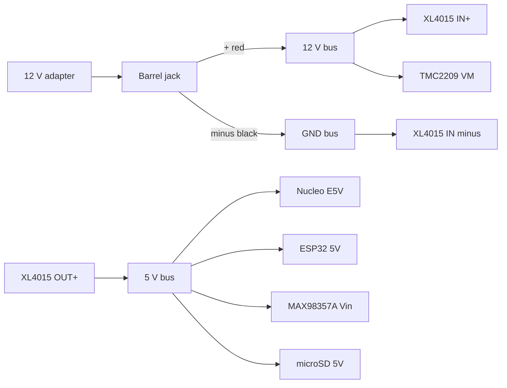
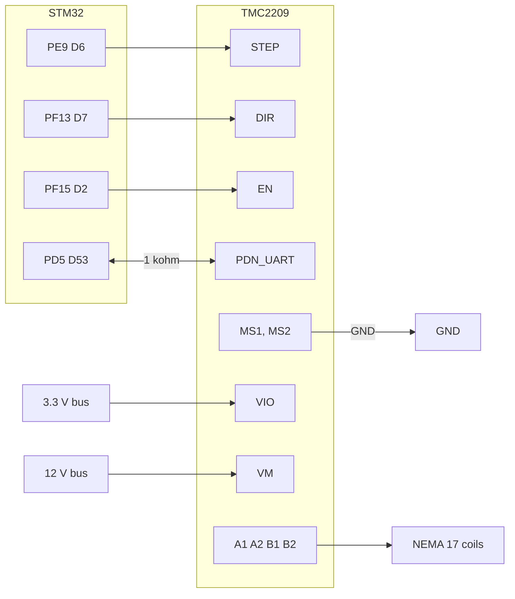
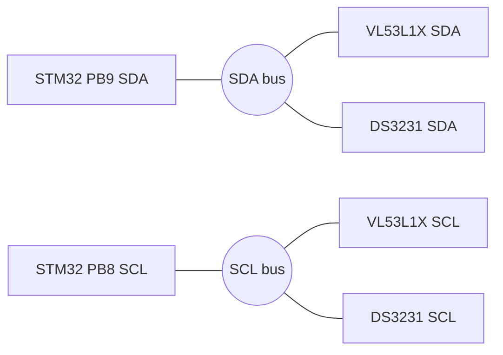

# Step 4: Wiring list

Every wire of the feeder, part by part: from which pin, to which pin, which colour, and what to measure before powering on. Pins follow the plan in [step 2, section 6](02_system_architecture.md#6-pin-plan).

**Status: written before testing.** Each wire is checked during the component tests of step 3; tick the **Checked** column when a wire is confirmed on the real part, and correct the row if the real module differs.

## Contents

| # | Section |
|---|---|
| 1 | [Before you start](#1-before-you-start) |
| 2 | [Wire colours](#2-wire-colours) |
| 3 | [Nucleo header map](#3-nucleo-header-map) |
| 4 | [Power](#4-power) |
| 5 | [ESP32S3 camera board](#5-esp32s3-camera-board) |
| 6 | [TMC2209 driver and stepper motor](#6-tmc2209-driver-and-stepper-motor) |
| 6B | [DRV8825 driver and stepper motor (local option)](#6b-drv8825-driver-and-stepper-motor-local-option) |
| 7 | [Load cell and HX711](#7-load-cell-and-hx711) |
| 8 | [Ultrasonic sensor](#8-ultrasonic-sensor) |
| 9 | [I2C bus: VL53L1X and DS3231](#9-i2c-bus-vl53l1x-and-ds3231) |
| 10 | [microSD card](#10-microsd-card) |
| 11 | [MAX98357A and speaker](#11-max98357a-and-speaker) |
| 12 | [Button and LED](#12-button-and-led) |
| 13 | [Totals per rail](#13-totals-per-rail) |
| 14 | [STM32CubeMX settings](#14-stm32cubemx-settings) |
| 15 | [Checklist before powering on](#15-checklist-before-powering-on) |

## 1. Before you start

1. **Labels on your modules can differ** from the names here (for example `DT` or `DOUT` on the HX711). Match by function, and write the label of your module in the Note column.
2. **The Nucleo header numbers** come from the NUCLEO-F439ZI user manual UM1974. Check each pin against the pinout figure of UM1974 and the STM32CubeMX pin view before the first connection.
3. **Wire with everything unplugged.** Power only after the checklist in section 15.
4. **Change one thing at a time**, then test.

## 2. Wire colours

Same colours on every part, so a wrong wire is visible at a glance.

| Colour | Use |
|---|---|
| Red | 12 V |
| Orange | 5 V |
| Yellow | 3.3 V |
| Black | GND |
| Blue | I2C SDA |
| White | I2C SCL |
| Green | UART (TX and RX) |
| Purple | SPI and I2S |
| Grey or brown | Other signals (STEP, DIR, EN, TRIG, ECHO, button, LED) |

Wire size: 22 AWG or thicker for 12 V, 5 V, GND and motor coils. Standard jumper wires for signals.

## 3. Nucleo header map

Only the pins this project uses. Header names follow UM1974: **CN7, CN8, CN9, CN10** are the inner (Arduino style) headers, **CN11 and CN12** the long outer (morpho) headers.

| STM32 pin | Header and label | Used for |
|---|---|---|
| PE9 | CN10, D6 | TMC2209 STEP |
| PF13 | CN10, D7 | TMC2209 DIR |
| PF15 | CN10, D2 | TMC2209 EN |
| PD5 | CN9, D53 | TMC2209 PDN_UART |
| PF14 | CN10, D4 | HX711 DOUT |
| PE13 | CN10, D3 | HX711 SCK |
| PD14 | CN7, D10 | Ultrasonic TRIG |
| PD15 | CN7, D9 | Ultrasonic ECHO |
| PB8 | CN7, D15 | I2C SCL |
| PB9 | CN7, D14 | I2C SDA |
| PA5 | CN7, D13 | SPI SCK |
| PA6 | CN7, D12 | SPI MISO |
| PB5 | CN7, D22 | SPI MOSI |
| PE11 | CN10, D5 | SD card CS |
| PC10 | CN8, D45 | I2S BCLK |
| PC12 | CN8, D47 | I2S DIN |
| PA4 | CN7, D24 | I2S LRC |
| PC6 | CN7, D16 | UART TX to ESP32 |
| PC7 | CN7, D21 | UART RX from ESP32 |
| PF12 | CN7, D8 | Button |
| PG14 | CN10, D1 | Status LED |
| 3V3 | CN8, 3V3 | 3.3 V output |
| 5V | CN8, 5V | 5 V (see power section) |
| GND | CN8, GND (several GND pins on every header) | Ground |
| E5V | CN11, E5V | External 5 V input |

## 4. Power

| # | From | To | Colour | Measure before connecting | Checked |
|---|---|---|---|---|---|
| P1 | Barrel jack centre (+) | **12 V bus** (screw terminal or Wago) | Red | 11.5 to 12.5 V between jack + and jack GND | |
| P2 | Barrel jack outer (GND) | **GND bus** | Black | 0 ohm between jack outer and GND bus | |
| P3 | 12 V bus | XL4015 `IN+` | Red | | |
| P4 | GND bus | XL4015 `IN-` | Black | | |
| P5 | XL4015 `OUT+` | **5 V bus** | Orange | **Turn the XL4015 screw until OUT reads 5.0 V with nothing connected** | |
| P6 | XL4015 `OUT-` | GND bus | Black | | |
| P7 | 5 V bus | Nucleo `E5V` (CN11) | Orange | 5.0 V; power jumper JP3 set to E5V (check UM1974) | |
| P8 | GND bus | Nucleo `GND` (CN11) | Black | | |
| P9 | Nucleo `3V3` (CN8) | **3.3 V bus** (breadboard rail) | Yellow | 3.3 V with the Nucleo powered | |
| P10 | Nucleo `GND` (CN8) | Breadboard GND rail | Black | | |

No fuse or reverse polarity protection is fitted. Before the first plug in, check that the adapter label shows the centre pin as +, and never let the 12 V bus touch GND or a board pin.

During development, power the Nucleo from USB and leave P7 unplugged. Connect P7 only when the whole feeder runs from the adapter.

## 5. ESP32S3 camera board

XIAO ESP32S3 Sense.

| # | XIAO pin | To | Colour | Measure or note | Checked |
|---|---|---|---|---|---|
| E1 | `5V` | 5 V bus | Orange | 5.0 V | |
| E2 | `GND` | GND bus | Black | | |
| E3 | `D6` (GPIO43, TX) | STM32 PC7 (CN7, D21) | Green | TX goes to RX | |
| E4 | `D7` (GPIO44, RX) | STM32 PC6 (CN7, D16) | Green | RX comes from TX | |
| E5 | 1000 uF and 100 nF capacitors | Between `5V` and `GND`, as close to the XIAO as possible | | Long leg (+) of the 1000 uF on 5V | |

Fallback, if the AI Thinker ESP32-CAM is used instead:

| # | ESP32-CAM pin | To | Note |
|---|---|---|---|
| E1 | `5V` | 5 V bus | Not the 3.3 V pin; the board browns out on 3.3 V |
| E2 | `GND` | GND bus | |
| E3 | `IO15` (UART2 TX in code) | STM32 PC7 | IO15 and IO14 are free when the onboard SD card is not used |
| E4 | `IO14` (UART2 RX in code) | STM32 PC6 | |
| E5 | 1000 uF and 100 nF capacitors | Between 5V and GND | Needed: this board resets on WiFi peaks without them |

## 6. TMC2209 driver and stepper motor

Pin names below are for the BigTreeTech and FYSETC modules. Some modules have separate `RX` and `TX` pins that are both the same `PDN_UART` line; use one of them.

| # | TMC2209 pin | To | Colour | Measure or note | Checked |
|---|---|---|---|---|---|
| M1 | `VM` | 12 V bus | Red | 12 V | |
| M2 | `GND` (power side, next to VM) | GND bus | Black | | |
| M3 | 1000 uF and 100 nF capacitors | Between `VM` and `GND`, at the driver | | Long leg (+) on VM | |
| M4 | `VIO` (also marked `VDD`) | 3.3 V bus | Yellow | 3.3 V | |
| M5 | `GND` (logic side, next to VIO) | GND rail | Black | | |
| M6 | `STEP` | STM32 PE9 (CN10, D6) | Grey | | |
| M7 | `DIR` | STM32 PF13 (CN10, D7) | Grey | | |
| M8 | `EN` | STM32 PF15 (CN10, D2) | Grey | Low = motor on, high = motor off | |
| M9 | 10 kohm resistor | Between `EN` and 3.3 V | | Keeps the motor off while the STM32 resets | |
| M10 | `PDN_UART` | 1 kohm resistor, then STM32 PD5 (CN9, D53) | Green | | |
| M11 | `MS1` | GND | Black | Driver UART address 0 | |
| M12 | `MS2` | GND | Black | Driver UART address 0 | |
| M13 | `CLK` (if present) | GND | Black | Uses the internal clock | |
| M14 | `A1`, `A2` (also `1A`, `1B`) | Motor coil A, both wires | | Find the pairs first (below) | |
| M15 | `B1`, `B2` (also `2A`, `2B`) | Motor coil B, both wires | | | |
| M16 | `VREF` potentiometer | | | Set to about 1.1 V for 0.8 A as a safe start; check the formula on the module page | |

How to find the coil pairs: with the motor unplugged, measure the resistance between wires. Two wires with **1 to 5 ohm** between them are one coil. Wires of different coils show no connection. If the motor only shakes, swap the two wires of one coil.

**Never plug or unplug the motor while the driver has 12 V.** This destroys the TMC2209.

## 6B. DRV8825 driver and stepper motor (local option)

Use this section instead of section 6 when the driver is a DRV8825 (sold locally) and not a TMC2209. Drawn in [circuit 1](circuits_by_part/01_stepper_motor_drv8825/README.md).

Breadboard layout: the DRV8825 straddles the middle gap in **columns 12 to 19**, turned so that **VMOT is top left (column 12, row f) and EN is bottom left (column 12, row e)**. Top half: power and motor. Bottom half: control. **Top + rail = 12 V, bottom + rail = 3.3 V.**

| Driver pin | Column | Row | Driver pin | Column | Row |
|---|---|---|---|---|---|
| VMOT | 12 | f | EN | 12 | e |
| GND | 13 | f | M0 | 13 | e |
| B2 | 14 | f | M1 | 14 | e |
| B1 | 15 | f | M2 | 15 | e |
| A1 | 16 | f | RST | 16 | e |
| A2 | 17 | f | SLP | 17 | e |
| FLT | 18 | f | STEP | 18 | e |
| GND | 19 | f | DIR | 19 | e |

| # | From | To | Colour | Note | Checked |
|---|---|---|---|---|---|
| V1 | DC jack `+` | Top + rail (12 V), column 3 | Red | | |
| V2 | DC jack `−` | Top − rail (GND), column 2 | Black | | |
| V3 | 1000 uF capacitor | Long leg (+) in the top + rail, column 10; short leg in the top − rail, column 7 | | Stripe side is the short leg | |
| V4 | VMOT (column 12) | Top + rail (12 V) | Red | From row j | |
| V5 | GND (column 13) | Top − rail (GND) | Black | From row j | |
| V6 | GND (column 19, above DIR) | No wire | | Linked to the other GND inside the board | |
| V7 | A2 (column 17) | Motor green | Green (motor cable) | Row j; coil A | |
| V8 | A1 (column 16) | Motor black | Black (motor cable) | Row i; coil A | |
| V9 | B1 (column 15) | Motor red | Red (motor cable) | Row h; coil B | |
| V10 | B2 (column 14) | Motor blue | Blue (motor cable) | Row g; coil B | |
| V11 | FLT (column 18) | No wire | | Fault output, not used | |
| V12 | EN (column 12) | Nucleo D2 · PF15 (CN10 pin 12) | Blue grey | Row b. Low = motor on | |
| V13 | 10 kohm resistor | Column 12 row a to bottom + rail (3.3 V) | | Keeps the motor off while the STM32 resets | |
| V14 | M0, M1 (columns 13, 14) | No wire | | Pulled to 0 inside the driver | |
| V15 | M2 (column 15) | Bottom + rail (3.3 V) | Yellow | Row a. With M0 = M1 = 0: 1/16 step, 3200 steps per turn | |
| V16 | RST (column 16) | Bottom + rail (3.3 V) | Yellow | Row a. High = driver running | |
| V17 | SLP (column 17) | Bottom + rail (3.3 V) | Yellow | Row a. High = driver awake | |
| V18 | STEP (column 18) | Nucleo D6 · PE9 (CN10 pin 4) | Grey | Row c | |
| V19 | DIR (column 19) | Nucleo D7 · PF13 (CN10 pin 2) | Brown | Row d | |
| V20 | Nucleo 3V3 (CN8 pin 7) | Bottom + rail (3.3 V), column 2 | Yellow | | |
| V21 | Nucleo GND (CN10 pin 5) | Bottom − rail (GND), column 3 | Black | | |
| V22 | Top − rail | Bottom − rail, column 1 | Black | Joins both GND rails | |

Current limit: the DRV8825 gives a current of 2 x Vref. Measure Vref between the potentiometer and GND with 12 V on, and set it to **about 0.5 V (1 A)**. Without a multimeter: turn the potentiometer to the lowest current (usually fully anticlockwise), run the motor, then turn it up in small steps until the motor turns without skipping, and stop there.

Differences from the TMC2209 wiring of section 6:

1. No UART wire: PD5 is not used and USART2 is not needed in CubeMX.
2. Microsteps are set by wires (M0, M1, M2), not in software.
3. No stall detection: the scale is the only jam check.
4. Nucleo pin numbers (CN10 pin 2, 4, 5, 12 and CN8 pin 7) come from the user manual UM1974: check them on the board before plugging.

## 7. Load cell and HX711

Drawn in [circuit 2](circuits_by_part/02_load_cell_hx711/README.md). Generic green HX711 board: 4 pin side (GND, DT, SCK, VCC) and 6 pin side (E+, E−, A−, A+, B−, B+). The 4 pin side plugs into **row a, columns 22 to 25** of the bottom half; the board hangs over the bottom edge.

| # | From | To | Colour | Measure or note | Checked |
|---|---|---|---|---|---|
| H1 | Load cell red | HX711 `E+` | Red (cell wire) | Colours vary by brand; see below | |
| H2 | Load cell black | HX711 `E-` | Black (cell wire) | | |
| H3 | Load cell white | HX711 `A-` | White (cell wire) | | |
| H4 | Load cell green | HX711 `A+` | Green (cell wire) | | |
| H5 | HX711 `B+`, `B-` | Not connected | | Channel B is not used | |
| H6 | HX711 `VCC` (column 25) | Bottom + rail (3.3 V), column 27 | Yellow | 3.3 V, so DT stays safe for the STM32 | |
| H7 | HX711 `GND` (column 22) | Bottom − rail (GND), column 20 | Black | | |
| H8 | HX711 `DT` or `DOUT` (column 23) | Nucleo D4 · PF14 (CN10 pin 8) | Brown | Row d | |
| H9 | HX711 `SCK` or `CLK` (column 24) | Nucleo D3 · PE13 (CN10 pin 10) | Grey | Row c | |
| H10 | Nucleo 3V3 (CN8 pin 7) | Bottom + rail (3.3 V), column 2 | Yellow | Same wire as V20 when circuit 1 is wired | |
| H11 | Nucleo GND (CN10 pin 5) | Bottom − rail (GND), column 3 | Black | Same wire as V21 when circuit 1 is wired | |
| H12 | HX711 `VDD` (SparkFun board only) | 3.3 V rail | Yellow | Must equal VCC; generic boards do not have it | |

The `RATE` pin (10 or 80 readings per second) is fixed on most generic boards at 10 per second, which gives less noise.

Checking the load cell colours: with the cell unplugged, the pair with the **highest** resistance (about 1 kohm) is the excitation pair (E+ and E minus); the other pair is the signal (A+ and A minus). If the weight reads negative, swap A+ and A minus.

Mounting: the arrow on the bar must point down, one end fixed to the base, the other end holding the bowl plate, with nothing else touching the plate.

## 8. Ultrasonic sensor

For the 3.3 V version (RCWL-1601 or HC-SR04P).

| # | Sensor pin | To | Colour | Measure or note | Checked |
|---|---|---|---|---|---|
| U1 | `VCC` | 3.3 V bus | Yellow | 3.3 V | |
| U2 | `Trig` | STM32 PD14 (CN7, D10) | Grey | | |
| U3 | `Echo` | STM32 PD15 (CN7, D9) | Grey | Must be 3.3 V high, not 5 V | |
| U4 | `GND` | GND rail | Black | | |

If a standard 5 V HC-SR04 is used instead: `VCC` to 5 V, and `Echo` through a divider (1 kohm from Echo to PD15, 2 kohm from PD15 to GND) so the STM32 sees 3.3 V.

## 9. I2C bus: VL53L1X and DS3231

Both parts share the same two wires. Most modules already have pull up resistors on SDA and SCL, so none are added.

| # | From | To | Colour | Measure or note | Checked |
|---|---|---|---|---|---|
| I1 | STM32 PB9 (CN7, D14) | SDA rail on the breadboard | Blue | | |
| I2 | STM32 PB8 (CN7, D15) | SCL rail on the breadboard | White | | |
| I3 | VL53L1X `VIN` | 3.3 V bus | Yellow | | |
| I4 | VL53L1X `GND` | GND rail | Black | | |
| I5 | VL53L1X `SDA` | SDA rail | Blue | | |
| I6 | VL53L1X `SCL` | SCL rail | White | | |
| I7 | VL53L1X `XSHUT` | Not connected | | Pulled up on the module; sensor always on | |
| I8 | VL53L1X `GPIO1` | Not connected | | Interrupt not used | |
| I9 | DS3231 `VCC` | 3.3 V bus | Yellow | | |
| I10 | DS3231 `GND` | GND rail | Black | | |
| I11 | DS3231 `SDA` | SDA rail | Blue | | |
| I12 | DS3231 `SCL` | SCL rail | White | | |
| I13 | DS3231 `SQW`, `32K` | Not connected | | Not used | |
| I14 | CR2032 coin cell | DS3231 holder | | On the common ZS-042 module, **remove the charging diode or its 200 ohm resistor** first | |
| I15 | Pull up check | | | With power on and nothing talking: SDA and SCL both read 3.3 V | |

If a module has no pull up resistors and both lines read 0 V, add 4.7 kohm from SDA to 3.3 V and from SCL to 3.3 V.

## 10. microSD card

For the Adafruit microSD breakout (or any breakout with its own 3.3 V regulator).

| # | Breakout pin | To | Colour | Measure or note | Checked |
|---|---|---|---|---|---|
| S1 | `5V` | 5 V bus | Orange | The breakout makes its own 3.3 V, which spares the Nucleo regulator | |
| S2 | `GND` | GND rail | Black | | |
| S3 | `CLK` | STM32 PA5 (CN7, D13) | Purple | | |
| S4 | `DO` (MISO) | STM32 PA6 (CN7, D12) | Purple | | |
| S5 | `DI` (MOSI) | STM32 PB5 (CN7, D22) | Purple | | |
| S6 | `CS` | STM32 PE11 (CN10, D5) | Purple | | |
| S7 | `CD` (card detect) | Not connected | | | |

Card: format as FAT32 on the computer before first use.

## 11. MAX98357A and speaker

For the Adafruit MAX98357A breakout.

| # | Breakout pin | To | Colour | Measure or note | Checked |
|---|---|---|---|---|---|
| A1 | `Vin` | 5 V bus | Orange | 5 V gives the full 3 W | |
| A2 | `GND` | GND rail | Black | | |
| A3 | `BCLK` | STM32 PC10 (CN8, D45) | Purple | | |
| A4 | `DIN` | STM32 PC12 (CN8, D47) | Purple | | |
| A5 | `LRC` | STM32 PA4 (CN7, D24) | Purple | | |
| A6 | `GAIN` | Not connected | | 9 dB; connect to GND for 12 dB if too quiet | |
| A7 | `SD` | Not connected | | Plays a mono mix of left and right | |
| A8 | Speaker `+` | Breakout output `+` | Red (speaker wire) | | |
| A9 | Speaker `minus` | Breakout output `minus` | Black (speaker wire) | **Never connect a speaker wire to GND**; both outputs carry signal | |

## 12. Button and LED

| # | From | To | Colour | Measure or note | Checked |
|---|---|---|---|---|---|
| B1 | Button leg 1 | STM32 PF12 (CN7, D8) | Grey | Internal pull up in the STM32 | |
| B2 | Button leg 2 | GND rail | Black | Pressed = 0 V on PF12 | |
| B3 | 100 nF capacitor | Between PF12 and GND | | Optional, reduces bounce | |
| L1 | STM32 PG14 (CN10, D1) | 330 ohm resistor | Grey | | |
| L2 | 330 ohm resistor | LED long leg (anode) | | | |
| L3 | LED short leg (cathode) | GND rail | Black | | |

## 13. Totals per rail

| Rail | Connected parts | Wires on the rail |
|---|---|---|
| 12 V | TMC2209 VM, XL4015 IN+ | P1, P3, M1 |
| 5 V | Nucleo E5V, ESP32 5V, MAX98357A Vin, microSD 5V | P5, P7, E1, A1, S1 |
| 3.3 V | TMC2209 VIO, HX711, ultrasonic, VL53L1X, DS3231, EN pull up | P9, M4, M9, H6, U1, I3, I9 |
| GND | Every part | P2, P4, P6, P8, P10, E2, M2, M5, M11, M12, M13, H7, U4, I4, I10, S2, A2, B2, L3 |

## 14. STM32CubeMX settings

Settings for each pin when creating the project in STM32CubeIDE.

### System

| Setting | Value |
|---|---|
| Board | NUCLEO-F439ZI (start from the board selector, then clear the default Ethernet and USB pins) |
| Clock (RCC) | HSE in bypass mode from the ST-LINK (8 MHz), system clock 180 MHz |
| Debug (SYS) | Serial Wire |
| Logs | USART3 on PD8 and PD9, 115200 baud, to the ST-LINK virtual serial port |

### Pins

| Pin | Mode in CubeMX | Pull | Start level | Other settings |
|---|---|---|---|---|
| PE9 | TIM1_CH1, PWM Generation CH1 | None | | Frequency set in code; one pulse per microstep |
| PF13 | GPIO_Output | None | Low | |
| PF15 | GPIO_Output | None | **High** (motor off at start) | |
| PD5 | USART2_TX, Single Wire (Half Duplex) | Pull up | | 115200 baud, 8N1 |
| PF14 | GPIO_Input | None | | |
| PE13 | GPIO_Output | None | **Low** (high for 60 us puts the HX711 to sleep) | |
| PD14 | GPIO_Output | None | Low | |
| PD15 | TIM4_CH4, Input Capture | None | | Both edges; timer clock 1 MHz (1 tick = 1 us) |
| PB8 | I2C1_SCL | (set by CubeMX) | | Fast mode, 400 kHz |
| PB9 | I2C1_SDA | (set by CubeMX) | | |
| PA5 | SPI1_SCK | None | | Full duplex master; prescaler 256 at start (about 350 kHz), then 8 (about 11 MHz) |
| PA6 | SPI1_MISO | Pull up | | |
| PB5 | SPI1_MOSI | None | | |
| PE11 | GPIO_Output | None | **High** (card not selected) | |
| PC10 | I2S3_CK | None | | Half duplex master transmit, Philips standard, 16 bit data, 16 kHz, MCLK off, DMA on SPI3_TX |
| PC12 | I2S3_SD | None | | |
| PA4 | I2S3_WS | None | | |
| PC6 | USART6_TX | None | | 115200 baud, 8N1, receive with interrupt or DMA |
| PC7 | USART6_RX | Pull up | | |
| PF12 | GPIO_EXTI12 | Pull up | | Falling edge interrupt |
| PG14 | GPIO_Output | None | Low | |

After assigning, CubeMX must show **no pin in red or orange**. If one is, the board default (often Ethernet or USB) is still using it: clear that peripheral.

## 15. Checklist before powering on

Go through it every time something new is wired.

| # | Check | How |
|---|---|---|
| 1 | Adapter unplugged and USB unplugged while wiring | |
| 2 | No short between 12 V and GND | Multimeter in resistance mode: not 0 ohm |
| 3 | No short between 5 V and GND | Same |
| 4 | No short between 3.3 V and GND | Same |
| 5 | Buck output is 5.0 V **before** it is connected to any board | Measure with only the adapter connected |
| 6 | No 12 V or 5 V wire on any STM32 signal pin | Follow every red and orange wire with your finger |
| 7 | Every part has its GND connected | Count the black wires against section 13 |
| 8 | TX goes to RX on every UART | E3, E4 |
| 9 | Motor coils in pairs, motor connected before power | M14, M15 |
| 10 | Capacitor polarity: long leg on + | E5, M3 |
| 11 | After power on: touch the regulators and the driver | Warm is normal, too hot to hold means power off now |
| 12 | After power on: 12 V, 5 V and 3.3 V measured on the rails | Within 5% |
