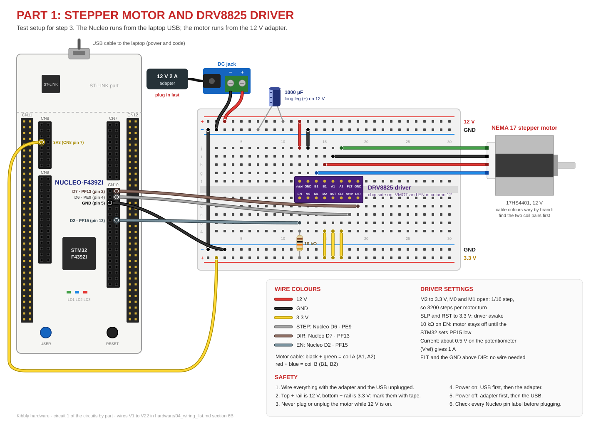

# Circuit 1: Stepper motor and DRV8825 driver



**What it is for:** the first milestone of the project, "the STM32 dispenses exactly N bursts on command". The Nucleo runs from the laptop USB; the motor runs from the 12 V adapter.

**Parts:** NUCLEO-F439ZI, NEMA 17 motor, DRV8825, 12 V adapter, DC jack, 1000 uF capacitor, 10 kohm resistor, breadboard, jumper wires, USB cable.

**Wire table:** wires V1 to V22 in [04_wiring_list.md, section 6B](../04_wiring_list.md#6b-drv8825-driver-and-stepper-motor-local-option).

## How the parts talk

```
Motor ──4 wires──► DRV8825 (A1, A2, B1, B2) ◄── STEP, DIR, EN ── Nucleo
                         ▲
                     12 V adapter
```

| Connection | What travels on it |
|---|---|
| Nucleo to driver (STEP, DIR, EN) | Small 3.3 V orders: one step, this direction, motor on or off |
| 12 V adapter to driver (VMOT, GND) | The power for the motor |
| Driver to motor (the 4 motor wires) | The strong current that turns the motor |

The Nucleo never powers the motor: it only gives orders, and the driver uses the 12 V to move the motor.

## The motor wires

The 4 coloured wires come from the motor and go **only to the driver**, through the breadboard columns: a wire plugged in the same column as a driver pin (rows f to j) is connected to that pin.

| Motor wire | Coil | Driver pin | Breadboard |
|---|---|---|---|
| Black | A | A1 | column 16, row i |
| Green | A | A2 | column 17, row j |
| Red | B | B1 | column 15, row h |
| Blue | B | B2 | column 14, row g |

1. **These colours are not power colours.** The motor's red and black wires are coil wires: never connect them to the 12 V or GND rail.
2. Colours vary by brand; the **pairs** matter. Touch two wire ends together and turn the shaft by hand: if it turns harder, those two wires are one coil. One pair goes to A1 and A2, the other to B1 and B2.
3. If the motor only vibrates, swap the two wires of one coil. If it turns the wrong way, swap one pair or change DIR in the code.

## Pins left empty on purpose

| Pin | Why |
|---|---|
| FLT (column 18, top) | Fault signal, not used |
| GND (column 19, top, above DIR) | Already linked inside to the other GND |
| M0, M1 (columns 13 and 14, bottom) | Left empty for 1/16 step |

## Wiring order

1. Everything unplugged: no adapter, no USB.
2. Mark the rails with tape: **top + rail "12 V"**, **bottom + rail "3.3 V"**.
3. Push the DRV8825 across the middle gap in columns 12 to 19, with **VMOT top left and EN bottom left**. The pin names are printed on the board (often underneath): check them. Stick the small heatsink on the chip if it came with one.
4. V22: join the two GND rails (column 1).
5. Control side: V13 (10 kohm, EN to 3.3 V), then V15, V16, V17 (M2, RST, SLP to 3.3 V).
6. Nucleo: V21 (GND) first, then V20 (3V3), then V12 (EN), V18 (STEP), V19 (DIR).
7. Motor: find the two coil pairs, then V7, V8 (coil A) and V9, V10 (coil B).
8. Power side: V3 (capacitor, long leg on 12 V), V4 (VMOT), V5 (GND), then V1 and V2 (DC jack).
9. Check before powering:
   1. No wire from the 12 V rail reaches the 3.3 V rail or a Nucleo pin.
   2. Capacitor long leg on the 12 V rail.
   3. Motor plugged in (never plug or unplug it with 12 V on).
10. Power on: USB first (the 10 kohm keeps the motor off), then the adapter. Power off: adapter first, then the USB.
11. Set the current: about 0.5 V on the potentiometer (Vref) for 1 A; section 6B explains the method without a multimeter.

The test program comes with the step 3 test file for this part.
