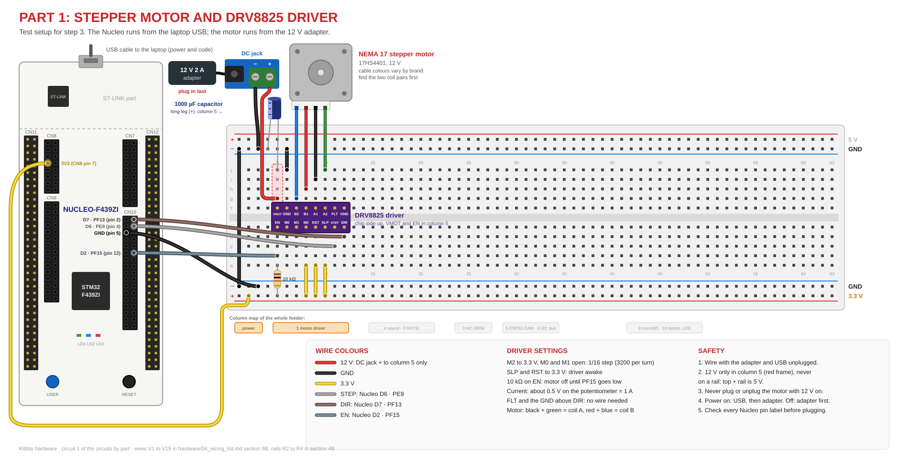

# Circuit 1: Stepper motor and DRV8825 driver



**What it is for:** the first milestone of the project, "the STM32 dispenses exactly N bursts on command". The Nucleo runs from the laptop USB; the motor runs from the 12 V adapter.

**Where on the board:** columns 5 to 12, both halves (see the [column map](../README.md#board-and-column-map)).

**Parts:** NUCLEO-F439ZI, NEMA 17 motor, DRV8825, 12 V adapter, DC jack, 470 uF capacitor, 10 kohm resistor, breadboard, jumper wires, USB cable.

**Wire table:** wires V1 to V19 in [04_wiring_list.md, section 6B](../../04_wiring_list.md#6b-drv8825-driver-and-stepper-motor-demo-driver), plus rails R2 to R4 in [section 4B](../../04_wiring_list.md#4b-breadboard-rails-and-power-entries).

## How the parts talk

```
Motor ──4 wires──► DRV8825 (A1, A2, B1, B2) ◄── STEP, DIR, EN ── Nucleo
                         ▲
                     12 V adapter (column 5 only)
```

| Connection | What travels on it |
|---|---|
| Nucleo to driver (STEP, DIR, EN) | Small 3.3 V orders: one step, this direction, motor on or off |
| 12 V adapter to driver (VMOT, GND) | The power for the motor |
| Driver to motor (the 4 motor wires) | The strong current that turns the motor |

The Nucleo never powers the motor: it only gives orders, and the driver uses the 12 V to move the motor.

## 12 V lives in one column only

The rails carry 5 V (top) and 3.3 V (bottom). **12 V is on no rail**: the DC jack + goes into **column 5, top half**, which is the driver's VMOT column (framed in red in the picture). The capacitor's long leg goes into the same column. Mark column 5 with red tape.

## The motor wires

The 4 coloured wires come from the motor and go **only to the driver**, through the breadboard columns: a wire plugged in the same column as a driver pin (rows f to j) is connected to that pin.

| Motor wire | Coil | Driver pin | Breadboard |
|---|---|---|---|
| Black | A | A1 | column 9, row i |
| Green | A | A2 | column 10, row j |
| Red | B | B1 | column 8, row h |
| Blue | B | B2 | column 7, row g |

1. **These colours are not power colours.** The motor's red and black wires are coil wires: never connect them to a rail.
2. Colours vary by brand; the **pairs** matter. Touch two wire ends together and turn the shaft by hand: if it turns harder, those two wires are one coil. One pair goes to A1 and A2, the other to B1 and B2.
3. If the motor only buzzes or shakes, the pairs are mixed: each pair must go on A1 and A2, or on B1 and B2. Swapping the two wires inside one coil only reverses the direction: do that, or change DIR in the code, if it turns the wrong way.

## Pins left empty on purpose

| Pin | Why |
|---|---|
| FLT (column 11, top) | Fault signal, not used |
| GND (column 12, top, above DIR) | Already linked inside to the other GND |
| M0, M1 (columns 6 and 7, bottom) | Left empty for 1/16 step |

## Checks before wiring

No power anywhere for these three checks.

1. **Driver:** the board must say **DRV8825** (usually purple). If it says A4988, stop: that board needs an extra 3.3 V wire, another Vref value and another microstep table, so this circuit does not fit it.
2. **Coil pairs:** multimeter on ohm, measure between the motor wires. Two wires with about **1.5 to 2 ohm** between them are one coil; wires of different coils read nothing (OL). The table above expects black and green as coil A, red and blue as coil B. Write down your pairs.
3. **Adapter polarity:** plug the adapter into the jack, with the jack wired to nothing. Multimeter on DC V, red probe on the jack `+` screw, black probe on `−`: it must read about **+12 V**. If it reads −12 V, stop: the screws are marked the other way, and nothing in the circuit protects against a reversed supply.

## Wiring order

1. Everything unplugged: no adapter, no USB.
2. Mark column 5 (top half) with red tape: "12 V".
3. Push the DRV8825 across the middle gap in columns 5 to 12, with **VMOT top left and EN bottom left**. The pin names are printed on the board (often underneath): check them. Stick the small heatsink on the chip if it came with one.
4. Rails: R4 (join the two GND rails, column 1), R3 (Nucleo GND), R2 (Nucleo 3V3).
5. Control side: V13 (10 kohm, EN to 3.3 V), then V15, V16, V17 (M2, RST, SLP to 3.3 V).
6. Nucleo signals: V12 (EN), V18 (STEP), V19 (DIR).
7. Motor: find the two coil pairs, then V7, V8 (coil A) and V9, V10 (coil B).
8. Power side: V5 (driver GND to the top − rail), V3 (capacitor, long leg in column 5), then V2 and V1 (DC jack − and +).
9. Check before powering:
   1. The 12 V wire goes into column 5 only, never into a rail.
   2. Capacitor long leg in column 5.
   3. Motor plugged in (never plug or unplug it with 12 V on).
10. Power on: USB first (the 10 kohm keeps the motor off), then the adapter. Power off: adapter first, then the USB.
11. Set the current before loading the program; the motor is still off, because the 10 kohm keeps EN high. Black probe on the top − rail, red probe on the metal top of the potentiometer: turn it gently until it reads **0.50 V** (1 A). A plastic screwdriver is safest; with a metal one, do not touch the pins around it.

## Test program

The motor turns one full turn forward, pauses, turns one turn back, rests, and repeats. Anyone in the team can copy the three code blocks below (each block has a copy button on GitHub) into a new STM32CubeIDE project.

### Make the project

1. STM32CubeIDE: **File, New, STM32 Project**, tab **Board Selector**, choose **NUCLEO-F439ZI**, and name the project `stepper_test`.
2. "Initialize all peripherals with their default Mode?": answer **No**, to keep the project small.
3. In the pin view, set **PE9**, **PF13** and **PF15** to **GPIO_Output**. The search box under the chip finds a pin by its name.
4. **System Core, GPIO, PF15**: set **GPIO output level** to **High**, so the motor starts off.
5. Save, and accept when it asks to generate the code.
6. Open `Core/Src/main.c` and paste the three blocks below between the matching `USER CODE` comments. Replace the empty comment pair with the whole block.
7. Plug in the USB, then the adapter, and check that Vref is set (wiring order step 11).
8. Click **Run** (the green play button). If it offers to update the ST-LINK firmware, accept.

### Code

Block 1, between `/* USER CODE BEGIN 0 */` and `/* USER CODE END 0 */`:

```c
/* USER CODE BEGIN 0 */
#define STEPS_PER_TURN 3200U   /* 1/16 step: M2 high, M0 and M1 low */
#define HALF_PERIOD_US 625U    /* 800 steps per second: one turn in 4 s */

static void delay_us(uint32_t us)
{
  uint32_t start = DWT->CYCCNT;
  uint32_t ticks = us * (SystemCoreClock / 1000000U);
  while ((DWT->CYCCNT - start) < ticks) { }
}

static void motor_enable(int on)
{
  /* EN is active low: 0 V turns the motor on */
  HAL_GPIO_WritePin(GPIOF, GPIO_PIN_15, on ? GPIO_PIN_RESET : GPIO_PIN_SET);
}

static void motor_steps(uint32_t steps, int forward)
{
  HAL_GPIO_WritePin(GPIOF, GPIO_PIN_13, forward ? GPIO_PIN_SET : GPIO_PIN_RESET);
  delay_us(5);  /* let DIR settle before the first step */
  for (uint32_t i = 0; i < steps; i++) {
    HAL_GPIO_WritePin(GPIOE, GPIO_PIN_9, GPIO_PIN_SET);
    delay_us(HALF_PERIOD_US);
    HAL_GPIO_WritePin(GPIOE, GPIO_PIN_9, GPIO_PIN_RESET);
    delay_us(HALF_PERIOD_US);
  }
}
/* USER CODE END 0 */
```

Block 2, between `/* USER CODE BEGIN 2 */` and `/* USER CODE END 2 */`:

```c
  /* USER CODE BEGIN 2 */
  CoreDebug->DEMCR |= CoreDebug_DEMCR_TRCENA_Msk;  /* cycle counter for delay_us */
  DWT->CYCCNT = 0;
  DWT->CTRL |= DWT_CTRL_CYCCNTENA_Msk;
  motor_enable(0);
  HAL_Delay(2000);
  /* USER CODE END 2 */
```

Block 3, inside `while (1)`, right after `/* USER CODE BEGIN 3 */`:

```c
    /* USER CODE BEGIN 3 */
    motor_enable(1);
    motor_steps(STEPS_PER_TURN, 1);  /* one turn forward */
    HAL_Delay(1000);
    motor_steps(STEPS_PER_TURN, 0);  /* one turn back */
    motor_enable(0);                 /* rest: motor free and cool */
    HAL_Delay(2000);
```

| Setting | Value | Meaning |
|---|---|---|
| `STEPS_PER_TURN` | 3200 | 200 full steps times 16 microsteps (M2 high, M0 and M1 low) |
| `HALF_PERIOD_US` | 625 | 800 steps per second, one turn in 4 s. A bigger value turns slower |
| STEP, DIR, EN | PE9 (D6), PF13 (D7), PF15 (D2) | Same pins as wires V18, V19 and V12 |

## First test

Stick a small tape flag on the motor shaft to see each turn.

| What you see | Meaning or fix |
|---|---|
| Exactly one turn forward in about 4 s, a pause, one turn back, a rest of 2 s, and again | **Pass.** The tape flag stops at the same place every time |
| Nothing moves | Check 12 V in column 5, 3.3 V on RST and SLP, 0 V on EN while it should move, and that Vref is not 0 |
| It buzzes or shakes but does not turn | The coil pairs are mixed: measure the pairs again. Each pair goes on A1 and A2, or on B1 and B2 |
| It turns the wrong way | Swap the two wires of one coil, or flip DIR in the code |
| It skips or grinds | Raise Vref a little (never above 0.75 V) or raise `HALF_PERIOD_US` |
| Motor or driver chip too hot to touch | Lower Vref, and stick the heatsink on the chip |

Write the result in a step 3 test file for this part, copied from the [test template](../../03_component_tests/test_template.md).
