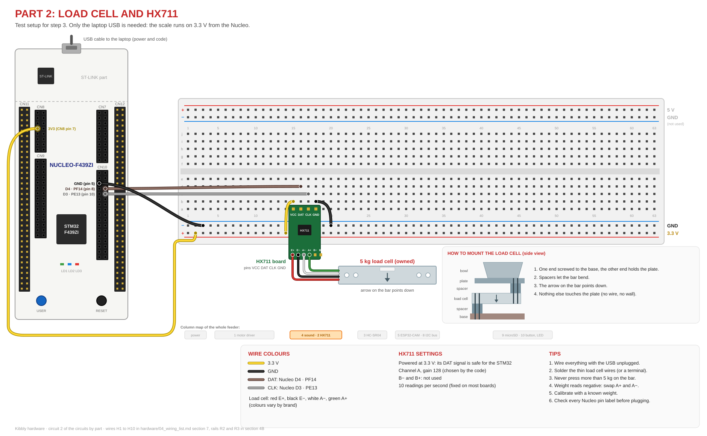

# Circuit 2: Load cell and HX711



**What it is for:** the second half of the first milestone, "the scale reads the grams". Only the laptop USB is needed: the HX711 and the load cell run on 3.3 V from the Nucleo.

**Where on the board:** columns 15 to 18, bottom half (see the [column map](../README.md#board-and-column-map)).

**Parts:** NUCLEO-F439ZI, 5 kg load cell (owned), HX711 board, breadboard, jumper wires, USB cable, a known weight or a kitchen scale for calibration.

**Wire table:** wires H1 to H10 in [04_wiring_list.md, section 7](../../04_wiring_list.md#7-load-cell-and-hx711), plus rails R2 and R3 in [section 4B](../../04_wiring_list.md#4b-breadboard-rails-and-power-entries).

## How the parts talk

```
Load cell ──4 thin wires──► HX711 (E+, E−, A−, A+) ── DT, SCK ──► Nucleo
                                   ▲
                             3.3 V from the Nucleo
```

| Connection | What travels on it |
|---|---|
| HX711 to load cell (E+, E−) | A steady voltage that powers the 4 tiny resistors glued on the bar (the strain gauges) |
| Load cell to HX711 (A+, A−) | A very small voltage that changes when the bar bends under weight |
| HX711 to Nucleo (DT, SCK) | The weight as a 24 bit number: the Nucleo pulses SCK, the HX711 answers bit by bit on DT |

The HX711 amplifies the tiny signal of the bar and turns it into a number. The Nucleo turns that number into grams with a calibration factor measured once with a known weight.

## The load cell wires

The 4 thin wires come from the bar and go **only to the HX711**, on its 6 pin side.

| Load cell wire | HX711 pin | Role |
|---|---|---|
| Red | E+ | Power for the bar (+) |
| Black | E− | Power for the bar (−) |
| White | A− | Signal (−) |
| Green | A+ | Signal (+) |

1. **These colours are not power colours of our code.** The bar's red and black wires go to E+ and E−, never to a rail.
2. Colours vary by brand. Without a multimeter, follow the label or the seller page of your bar. With a multimeter: the pair with the highest resistance (about 1 kohm) is E+ and E−.
3. If the weight reads negative when you press, swap A+ and A−.
4. The wires are thin and break easily: solder them to the HX711 pins, or use a small screw terminal. Do not pull on them.

## The 5 kg load cell

The team's cell is a **5 kg bar** (rating confirmed on 14 November 2026).

| Question | Answer |
|---|---|
| What sits on the bar | Plate and bowl (about 300 to 600 g) and one meal (up to about 300 g): under 1 kg |
| Is 5 kg enough | Yes, with a wide margin |
| Is it fine enough | Yes: with the HX711 it sees well under 1 g, so each 5 g burst shows clearly |
| What can break it | More than about 1.2 to 1.5 times its rating (6 to 7.5 kg) bends the bar for good. A dog putting a paw or its head on the bowl can push that much |

**Add an overload stop:** a screw under the free end of the plate, turned up until it almost touches. Set it with about 5 kg on the plate (a 5 L bottle of water weighs 5 kg): the plate must not touch the screw at 5 kg, but must land on it soon after. Then a heavy push rests on the screw instead of bending the bar.

## The HX711 on the breadboard

The 4 pin side (GND, DT, SCK, VCC) plugs into **row a, columns 15 to 18**, and the board hangs over the bottom edge of the breadboard. Check the order printed on your board: if it is different, keep the same wires but follow the labels.

| Pin left empty | Why |
|---|---|
| B−, B+ | Second channel, not used |

Many HX711 boards come with their pins not soldered: solder the 4 pin header (and the load cell wires) first.

## Mounting the load cell

The bar measures weight by bending a tiny amount, so it must be mounted like a diving board:

1. One end screwed to the base, with a spacer under it.
2. The other end holds the bowl plate, with a spacer between the bar and the plate.
3. The arrow on the bar points down (in the direction of the weight).
4. Nothing else touches the plate: no wire, no wall, no screw (except the overload stop, which only touches above 5 kg).

For the first test, the bar can lie on the table with a weight pressing its free end by hand: the number must change.

## Wiring order

1. USB unplugged.
2. Solder the header and the load cell wires to the HX711 if needed (H1 to H4).
3. Push the HX711 4 pin header into row a, columns 15 to 18.
4. R2 and R3: Nucleo 3V3 and GND to the bottom rails (already there if circuit 1 is wired).
5. H7: HX711 GND (column 15) to the bottom − rail.
6. H6: HX711 VCC (column 18) to the bottom + rail (3.3 V).
7. H8: DT (column 16) to Nucleo D4 · PF14. H9: SCK (column 17) to Nucleo D3 · PE13.
8. Check: VCC goes to the bottom + rail (3.3 V), not to the top + rail (5 V).
9. Plug in the USB.

## First test

1. Empty scale: the number shown is the zero (tare).
2. Put a known weight (for example 200 g checked on a kitchen scale): the change in the number divided by 200 is the calibration factor.
3. The test program and the results table come with the step 3 test file for this part.
