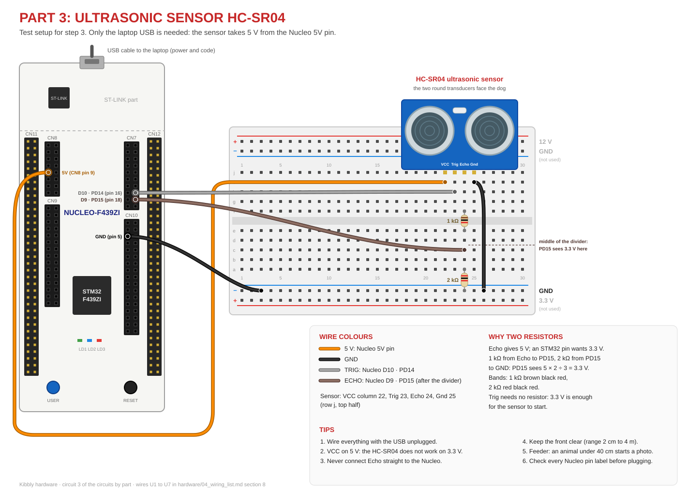

# Circuit 3: Ultrasonic sensor HC-SR04



**What it is for:** the sensor that notices an animal in front of the bowl and starts the photo. Only the laptop USB is needed: the sensor takes 5 V from the Nucleo 5V pin.

**Parts:** NUCLEO-F439ZI, HC-SR04, one 1 kohm resistor, one 2 kohm resistor, breadboard, jumper wires, USB cable.

**Wire table:** wires U1 to U7 in [04_wiring_list.md, section 8](../../04_wiring_list.md#8-ultrasonic-sensor).

## How it measures

```
Nucleo ── Trig (10 µs pulse) ──► HC-SR04 ──► sends a sound burst (40 kHz, silent for us)
Nucleo ◄── Echo (pulse, through the divider) ── HC-SR04 ◄── the sound bounces back
```

1. The Nucleo sends a 10 µs pulse on **Trig**.
2. The sensor sends a short ultrasonic burst and raises **Echo** until the sound comes back.
3. The Nucleo times the Echo pulse with timer TIM4: **distance in cm = pulse length in µs ÷ 58**.
4. Under 40 cm means an animal is in front of the bowl.

## Why two resistors

The HC-SR04 runs on 5 V, so its **Echo** pin goes up to 5 V. An STM32 pin wants 3.3 V. The two resistors form a **voltage divider**:

| Resistor | From | To | Colour bands |
|---|---|---|---|
| 1 kohm | Echo (column 24, top half) | Column 24, bottom half, across the middle gap | brown, black, red |
| 2 kohm | Column 24, bottom half | Bottom − rail (GND) | red, black, red |

The middle point (column 24, bottom half) sees 5 V × 2 ÷ 3 = **3.3 V**: this is where the Nucleo PD15 wire goes. **Never connect Echo straight to the Nucleo.**

**Trig** needs no resistor: the Nucleo sends 3.3 V, which the sensor accepts as "high".

## Where 5 V comes from

Our breadboard rails are 12 V (top) and 3.3 V (bottom); there is no 5 V rail. For this test the sensor takes 5 V **straight from the Nucleo 5V pin** (CN8 pin 9) with its own orange wire, so a 5 V rail can never be mixed up with the 12 V one. In the full circuit, 5 V comes from the 5 V supply of circuit 10.

## The sensor on the breadboard

The 4 pins plug into **row j, columns 22 to 25** (VCC, Trig, Echo, Gnd), and the sensor stands up over the top edge with its two round transducers facing out. Check the order printed on your sensor. In the feeder, the sensor is mounted on the front, facing the dog, and joined by 4 female to male jumper wires.

## Wiring order

1. USB unplugged.
2. Push the HC-SR04 into row j, columns 22 to 25.
3. U3: 1 kohm across the middle gap in column 24 (row f to row e).
4. U4: 2 kohm from column 24, row a, to the bottom − rail.
5. U6: sensor Gnd (column 25) to the bottom − rail. U7: Nucleo GND to the bottom − rail.
6. U2: Trig (column 23) to Nucleo D10 · PD14.
7. U5: middle of the divider (column 24, bottom half) to Nucleo D9 · PD15.
8. U1 last: sensor VCC (column 22) to Nucleo 5V.
9. Check: no wire from column 24 **top half** (Echo, 5 V) goes to the Nucleo. Only the bottom half of column 24 does.
10. Plug in the USB.

## First test

1. Point the sensor at a wall 50 cm away: the reading must be about 50 cm.
2. Move a hand closer: below 40 cm the program reports "animal present".
3. The test program and the results table come with the step 3 test file for this part.
