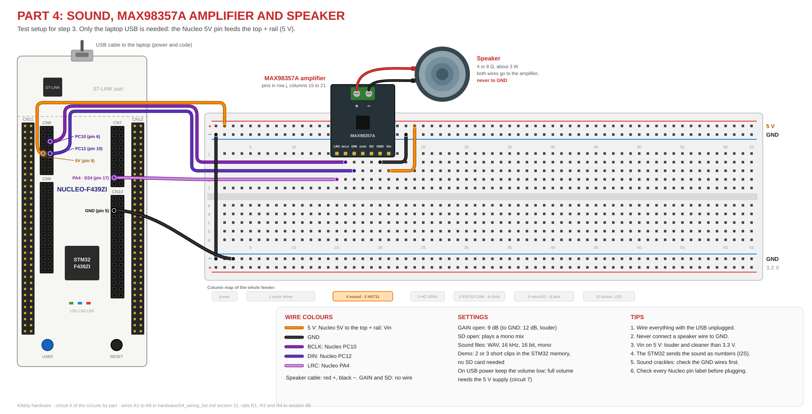

# Circuit 4: Sound, MAX98357A amplifier and speaker



**What it is for:** the "chime" of the demo: Kibbly calls each dog by name ("Biscuit!") or plays a chime at meal time. Only the laptop USB is needed for the test: the amplifier takes 5 V from the Nucleo 5V pin.

**Parts:** NUCLEO-F439ZI, MAX98357A amplifier board, speaker (4 or 8 ohm, about 3 W), breadboard, jumper wires, USB cable.

**Wire table:** wires A1 to A12 in [04_wiring_list.md, section 11](../../04_wiring_list.md#11-max98357a-and-speaker).

## How the sound travels

```
STM32 memory (WAV clip) ── I2S: BCLK, LRC, DIN ──► MAX98357A ──► speaker
                                                       ▲
                                                 5 V from the Nucleo
```

| Wire | Role |
|---|---|
| BCLK (bit clock, PC10) | Ticks once for every bit of sound data |
| LRC (left or right clock, PA4) | Marks the start of each sound sample (16 000 per second) |
| DIN (data in, PC12) | The sound itself, as numbers |

The STM32 sends the sound **as numbers** (I2S, a digital audio link), and the MAX98357A turns them into the speaker signal and amplifies it. Because the sound stays digital up to the amplifier, the motor noise does not get into it.

**For the demo, no SD card is needed:** 2 or 3 short clips (one call per dog and a chime, WAV, 16 kHz, 16 bit, mono) are stored in the STM32 memory, which holds about 30 seconds of sound. The microSD card (circuit 9) comes later, so new calls recorded in the app can be sent to the feeder.

## The speaker wires

Both speaker wires go **only to the amplifier's screw terminal** (+ and −). Both outputs carry the sound signal, so **never connect a speaker wire to GND**: that can destroy the amplifier. The red and black of the speaker cable are not power colours.

## The amplifier on the breadboard

The 7 pins plug into **row j, columns 5 to 11** (LRC, BCLK, DIN, GAIN, SD, GND, Vin) and the board stands over the top edge with the speaker terminal at the top. Check the order printed on your board.

5 V and GND reach the board through **two short jumpers across the middle gap** (columns 10 and 11), because the Nucleo wires arrive in the bottom half.

| Pin left empty | Why |
|---|---|
| GAIN | Open = 9 dB. Connect it to GND for 12 dB if the sound is too quiet |
| SD | Open = plays a mono mix of left and right |

## Power for the test

From the laptop USB, the Nucleo 5V pin can feed the amplifier at **low volume**. Full volume can draw up to 0.8 A, more than the USB gives: it needs the 5 V supply of circuit 7 (power). Keep the volume low in the test program.

## Wiring order

1. USB unplugged.
2. Push the MAX98357A into row j, columns 5 to 11.
3. Speaker: A8 and A9 into the screw terminal (+ and −). Tighten the screws.
4. A2 and A11: GND jumper across the gap in column 10, then column 10 row a to the bottom − rail. A12: Nucleo GND to the bottom − rail.
5. A3: BCLK (column 6) to Nucleo PC10. A4: DIN (column 7) to Nucleo PC12. A5: LRC (column 5) to Nucleo PA4.
6. A1 and A10 last: 5 V jumper across the gap in column 11, then Nucleo 5V to column 11, row c.
7. Check: no speaker wire on a GND rail; 5 V goes only to Vin.
8. Plug in the USB.

## First test

1. Play a 1 second beep (a tone made by the program): it must be clean, without crackle.
2. Play a stored clip ("Biscuit!").
3. The test program and the results table come with the step 3 test file for this part.
