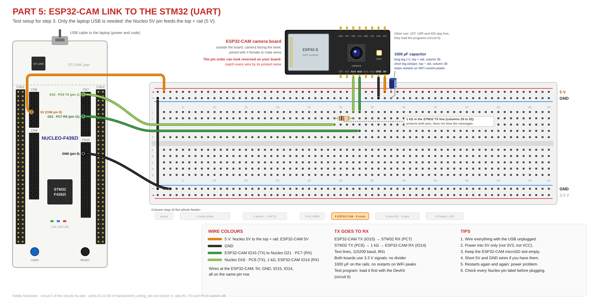

# Circuit 5: ESP32-CAM link to the STM32



**What it is for:** the link between the two boards of the feeder. The STM32 asks for a photo (`PHOTO`), the ESP32-CAM takes it, asks the AI server which dog it is and sends the answer back (`DOG,biscuit,94`). Only the laptop USB is needed for the test: the Nucleo 5V pin feeds the top + rail (5 V).

**Where on the board:** columns 29 to 33, top half; the 5 V wire, the GND wire and the capacitor go into the top rails just right of it, at columns 36 to 38 (see the [column map](../README.md#board-and-column-map)). The ESP32-CAM itself sits outside the board.

**Parts:** NUCLEO-F439ZI, ESP32-CAM, one 470 uF capacitor, one 1 kohm resistor, breadboard, 4 female to male jumper wires for the ESP32-CAM, other jumper wires, USB cable.

**Wire table:** wires E1 to E9 in [04_wiring_list.md, section 5](../../04_wiring_list.md#5-esp32-cam-camera-board), plus rails R1, R3 and R4 in [section 4B](../../04_wiring_list.md#4b-breadboard-rails-and-power-entries).

## How the boards talk

```
STM32 PC6 (TX) ── 1 kohm ──► IO14 (RX)  ESP32-CAM
STM32 PC7 (RX) ◄──────────── IO15 (TX)  ESP32-CAM
```

The link is a UART: one wire for each direction, and **the TX of one board goes to the RX of the other**. The messages are short text lines (115200 baud), so they can be read and typed in a serial monitor while testing.

| Direction | Example | Meaning |
|---|---|---|
| STM32 to ESP32-CAM | `PHOTO` | An animal is in front of the bowl: take a photo |
| ESP32-CAM to STM32 | `DOG,biscuit,94` | It is Biscuit, 94 % sure |
| Both | `OK`, `ERR` | Reply to every message, so a lost message is noticed |

The full list is in [step 2, UART messages](../../02_system_architecture.md#uart-messages-between-the-boards). Both boards use 3.3 V signals, so the wires go straight across: no divider, unlike the HC-SR04 Echo.

## Which ESP32-CAM pins, and why

The 4 wires all come from the same row of pins: 5V, GND, IO12, IO13, IO15, IO14, IO2, IO4. The names are printed on the board; seen from one side the row reads 5V to IO4, from the other side IO4 to 5V, so **match every wire by its name, not by its position**.

| Pin | Use | Why this pin |
|---|---|---|
| 5V | Power in | The board needs 5 V: on 3.3 V it restarts as soon as WiFi starts |
| GND | Ground | The one next to 5V |
| IO15 | TX: sends to the STM32 | Free, because the microSD slot of the ESP32-CAM is not used |
| IO14 | RX: receives from the STM32 | Same |

| Pins left free | Why |
|---|---|
| U0T, U0R, IO0 (other row) | They load programs into the ESP32-CAM with the DevKit (circuit 6) |
| IO12 | Must stay low while the board starts, or it does not boot |
| IO4 | Drives the bright flash LED |
| IO2, IO13 | Not needed |
| 3V3, VCC (other row) | Not used: power goes into 5V only. VCC is an output |

Keep the **microSD slot of the ESP32-CAM empty**: a card would share IO14 and IO15 with the link.

## The two extra parts

| Part | Where | Why |
|---|---|---|
| 470 uF capacitor | Column 38: long leg (+) in the top + rail, short leg (stripe side) in the top − rail | WiFi makes the ESP32-CAM draw short current peaks. Without a reserve next to it, the 5 V dips and the board restarts |
| 1 kohm resistor (brown, black, red) | Lying flat in row i, from column 29 to column 32 | Sits in the STM32 TX line. If the ESP32-CAM is unpowered while the Nucleo sends, or if a pin is set wrong in the code, only a small current can flow, so neither pin is damaged. At 115200 baud it does not slow the messages |

The 100 nF capacitor of the first plan is left out here: the ESP32-CAM already has small capacitors next to its chips. What it lacks is the big reserve, which the 470 uF gives.

## Power for the test

From the laptop USB, the Nucleo 5V pin (wire R1) feeds the ESP32-CAM, which is enough for the link test. With WiFi and the camera on, the ESP32-CAM adds short peaks of about 0.3 A to the Nucleo's own current, close to what a laptop USB port gives. If it restarts again and again (its start message keeps showing up in the STM32 log), feed the top + rail from the 5 V supply of circuit 7 (power).

Use the shortest female to male wires you have for 5V and GND: long thin wires make the 5 V dip more on WiFi peaks.

## Wiring order

1. USB unplugged.
2. Rails: R4 (join the two GND rails, column 1), R3 (Nucleo GND), R1 (Nucleo 5V to the top + rail).
3. E6: 1 kohm resistor lying flat in row i, legs in columns 29 and 32.
4. E5: 470 uF capacitor in column 38, long leg in the top + rail, short leg in the top − rail.
5. E8: column 29 (row h) to Nucleo D16 · PC6 (CN7 pin 1). E7: column 33 (row g) to Nucleo D21 · PC7 (CN7 pin 11).
6. ESP32-CAM, with 4 female to male wires: E2 (GND to the top − rail, column 36), E3 (IO15 to column 33), E4 (IO14 to column 32), then E1 (5V to the top + rail, column 37).
7. Check before powering:
   1. The power wire is on the ESP32-CAM **5V** pin, not 3V3 or VCC.
   2. Column 33 joins IO15 and PC7; column 32 joins IO14 and the resistor; column 29 joins the resistor and PC6.
   3. Capacitor long leg in the top + rail.
   4. The microSD slot of the ESP32-CAM is empty.
8. Plug in the USB.

## First test

The ESP32-CAM needs its test program first. It has no USB port, so the program is loaded through the DevKit: that is circuit 6 (next). This circuit can be wired before.

1. The STM32 sends a test line every second and the ESP32-CAM sends it back. The STM32 prints both on the laptop (ST-LINK serial port, 115200 baud): every line must come back unchanged.
2. Unplug the IO15 wire (E3) at the board: the STM32 must report that no answer came back. Plug it back.
3. Turn on the ESP32-CAM WiFi: the link must keep working for 5 minutes with no restart.
4. The test program and the results table come with the step 3 test file for this part.
