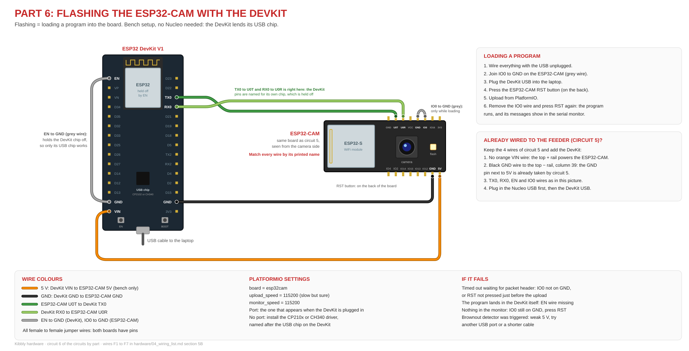

# Circuit 6: Flashing the ESP32-CAM with the DevKit



**What it is for:** flashing means loading a program into a board. The ESP32-CAM has no USB port, so it cannot take a program straight from the laptop. The ESP32 DevKit V1 has one: with its own chip held off, its USB chip passes the program on to the ESP32-CAM. The same wires then carry the messages the ESP32-CAM prints, which is how its code is debugged.

**Where:** on the table next to the laptop, with no breadboard and no Nucleo. A second way, with the ESP32-CAM still wired to the feeder, is at the end of this page.

**Parts:** ESP32 DevKit V1, ESP32-CAM, 6 female to female jumper wires, micro USB cable.

**Wire table:** wires F1 to F7 in [04_wiring_list.md, section 5B](../../04_wiring_list.md#5b-flashing-the-esp32-cam-with-the-devkit).

## How it works

```
Laptop ──USB──► DevKit USB chip ── RX0 ──► U0R  ESP32-CAM
                                ◄── TX0 ── U0T
                DevKit ESP32: held off (EN on GND)
```

| Wire | Why |
|---|---|
| EN to GND on the DevKit | Holds the DevKit's own ESP32 off, so the program goes to the ESP32-CAM and not into the DevKit |
| TX0 to U0T, RX0 to U0R | The DevKit pins are named for its own chip. With that chip off, TX0 is where the USB chip listens and RX0 is where it talks, so TX goes to TX here |
| VIN to 5V, GND to GND | The DevKit passes the 5 V of the laptop USB to the ESP32-CAM |
| IO0 to GND on the ESP32-CAM | Tells the ESP32-CAM, when it starts, to wait for a new program instead of running the old one |

## The pins

| Board | Pins used | Where they are |
|---|---|---|
| DevKit V1 (30 pins) | EN, GND, VIN | Left row: EN at the top, GND and VIN at the bottom |
| DevKit V1 | TX0, RX0, GND | Right row: TX0 and RX0 third and fourth from the top, GND second from the bottom |
| ESP32-CAM | U0T, U0R, IO0, GND | The row not used by circuit 5; use the GND next to IO0 |
| ESP32-CAM | 5V, GND | The row used by circuit 5; use the GND next to 5V |

Some DevKits print TX and RX, or TXD and RXD: these are the same pins. On both boards, **match every wire by its printed name**, because the order looks reversed from the other side of a board.

## Loading a program

1. Wire everything with the USB unplugged.
2. Join IO0 to GND on the ESP32-CAM (grey wire F6).
3. Plug the DevKit USB into the laptop.
4. Press the RST button of the ESP32-CAM (a small button, on the back of the board).
5. Upload from PlatformIO (settings below).
6. Remove the IO0 wire and press RST again: the program runs. Open the serial monitor (115200 baud) to read its messages.

For each new version: IO0 back on GND, press RST, upload, remove IO0, press RST.

## PlatformIO settings

In `firmware/esp32/platformio.ini`, written in step 5:

```
[env:esp32cam]
platform = espressif32
board = esp32cam
framework = arduino
upload_speed = 115200
monitor_speed = 115200
```

The upload speed is kept low on purpose: through jumper wires and the DevKit chip, 115200 is slower but much more reliable than the default. If no port appears when the DevKit is plugged in, install the driver for the USB chip printed on the DevKit (CP2102: Silicon Labs CP210x driver; CH340: WCH CH340 driver).

## If it fails

| Message or sign | Cause | Fix |
|---|---|---|
| `Timed out waiting for packet header` | The ESP32-CAM is not waiting for a program | Check IO0 is on GND, press RST, then upload at once |
| The program goes into the DevKit itself | EN is not on GND | Check wire F1 |
| Nothing in the serial monitor | IO0 is still on GND, so the program does not start | Remove IO0, press RST |
| `Brownout detector was triggered` | The 5 V is too weak | Another USB port, a shorter USB cable, or the second way below |
| Unreadable characters | Wrong monitor speed | Set 115200 |

## Second way: the ESP32-CAM already wired to the feeder

After circuit 5, the ESP32-CAM does not need to be unplugged to get a new program. Keep the 4 wires of circuit 5 and change this:

| Change | Why |
|---|---|
| No VIN wire (F2) | The top + rail already powers the ESP32-CAM; two supplies must never meet on one pin |
| Black GND wire (F3) to the top − rail, column 39 | The GND next to 5V is already taken by circuit 5 (wire E2) |
| F1, F4, F5 and F6 as in the picture | Same as on the table |
| Plug in the Nucleo USB first, then the DevKit USB | So the DevKit never sends into an unpowered ESP32-CAM |

With both USB cables in, the laptop shows two serial ports, one for the STM32 and one for the ESP32-CAM, so the link of circuit 5 can be watched from both ends at once.

## First test

1. Load a small test program that prints a line every second: the line must show in the serial monitor.
2. Load the link test program and run the first test of [circuit 5](../05_esp32_cam_link/README.md#first-test).
3. The test programs and the results table come with the step 3 test file for this part.
