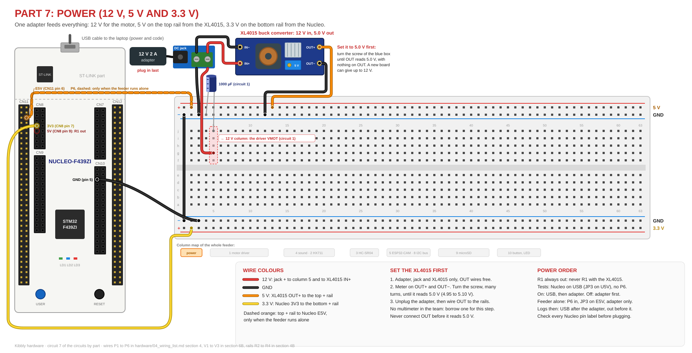

# Circuit 7: Power (12 V, 5 V and 3.3 V)



**What it is for:** one 12 V adapter feeds the whole feeder. The motor driver takes the 12 V; the XL4015 buck converter turns 12 V into 5 V for the top + rail (amplifier, HC-SR04, ESP32-CAM, microSD); the Nucleo makes the 3.3 V of the bottom + rail. From this circuit on, the 5 V rail no longer comes from the laptop USB (wire R1 is removed), so the amplifier can play at full volume and the ESP32-CAM gets enough current for WiFi.

**Where on the board:** the 12 V stays in column 5 (circuit 1). The 5 V enters the top rails at columns 12 and 13, right under the output end of the XL4015; the rail holes of columns 15 to 21 are covered by the amplifier board of circuit 4. The adapter, the jack and the XL4015 sit above the board.

**Parts:** 12 V adapter (2 A, 3 A better), DC jack module with screw terminals, XL4015 buck converter, NUCLEO-F439ZI, breadboard, jumper wires (22 AWG for the power wires if you have them), and a **multimeter, borrowed for this step**.

**Wire table:** wires P1 to P6 in [04_wiring_list.md, section 4](../../04_wiring_list.md#4-power), plus V1 to V3 in [section 6B](../../04_wiring_list.md#6b-drv8825-driver-and-stepper-motor-demo-driver) and rails R2 to R4 in [section 4B](../../04_wiring_list.md#4b-breadboard-rails-and-power-entries). R1 is removed.

## How the power flows

```
12 V adapter ──► DC jack ──┬──► column 5: driver VMOT and motor            12 V
                           └──► XL4015 ──► top + rail                       5 V
                                              ├── amplifier, HC-SR04, ESP32-CAM, microSD
                                              └── Nucleo E5V (feeder alone only)
Nucleo 3V3 regulator ──► bottom + rail                                      3.3 V
                              └── HX711, clock, tank sensor, driver control pins
All GND joined: jack −, XL4015 OUT−, Nucleo GND, both − rails
```

| Rail | Comes from | Feeds | Peak current |
|---|---|---|---|
| 12 V (column 5) | Adapter, through the DC jack | DRV8825 and motor | 0.8 A |
| 12 V (XL4015 input) | Adapter, second wire in the same jack screws | XL4015 | about 0.8 A |
| 5 V (top + rail) | XL4015 | Amplifier 0.8 A, ESP32-CAM 0.5 A, Nucleo 0.2 A (feeder alone), HC-SR04 and microSD 0.1 A | about 1.6 A |
| 3.3 V (bottom + rail) | Nucleo regulator (500 mA max) | HX711, VL53L0X, DS3231, driver control pins | under 0.1 A |

Total from the adapter: about 1.6 A, so a 2 A adapter is enough and 3 A leaves margin.

## Why two wires in each jack screw

The 12 V for the XL4015 is taken straight at the jack screws, not from column 5. A breadboard contact is made for about 1 A; if the XL4015 took its 12 V from column 5, the motor and the XL4015 together (about 1.6 A) would pass through the single contact of the jack wire. At the jack, each path gets its own wire. Twist the two wire ends together before tightening the screw, then pull each wire gently to check it holds.

Same idea on the 5 V side: the XL4015 output reaches the rails with its own two wires (orange and black), so the return current of the 5 V parts does not share the 12 V ground wire.

## The XL4015 terminals

Most XL4015 boards have 4 solder pads (IN+, IN−, OUT+, OUT−); some have screw terminals. With pads only, solder a short wire to each pad once (ask Hedi or the lab), ending in a male pin for the breadboard. The pad order differs between boards: **follow the printed names**, not the position in the picture.

## Before anything: set the XL4015 to 5.0 V

A new XL4015 can come set to any voltage up to almost 12 V. Connected like that, it would destroy the ESP32-CAM, the amplifier and the Nucleo at once. Set it first, with nothing on its output:

1. Adapter unplugged. Wire only the adapter, the jack and the XL4015 input (P1, P2, P3). OUT+ and OUT− stay free.
2. Plug in the adapter. Put the multimeter (DC volts) on OUT+ and OUT−.
3. Turn the small screw of the blue box. It is a multi turn screw: it can take 10 or more turns before the voltage moves. If the voltage goes the wrong way, turn the other way. Stop at **5.0 V** (between 4.95 and 5.10 V).
4. Unplug the adapter. Only now wire OUT+ and OUT− to the rails (P4, P5).

**No multimeter in the team:** it was taken off the parts list, but this step needs one. Borrow one from the lab or the ISS group for 10 minutes; never guess this voltage.

## Two ways to power the Nucleo

| | Tests (laptop next to the feeder) | Feeder alone (no laptop) |
|---|---|---|
| Nucleo power | Laptop USB, power jumper JP3 on U5V (as it comes) | Top + rail through E5V (wire P6), JP3 on E5V |
| Wire P6 | Not fitted | Top + rail, column 2, to Nucleo E5V (CN11 pin 6) |
| Power on | USB first, then the adapter | Adapter only; for logs, plug the USB in after the adapter |
| Power off | Adapter first, then the USB | USB out first, then the adapter |

In both ways **R1 stays out**. R1 joined the Nucleo 5V pin to the top + rail; with the XL4015 on the same rail, two 5 V sources would fight. P6 goes into the rail hole R1 used (top + rail, column 2), so it cannot go in while R1 is still there.

JP3 is the power jumper of the Nucleo; its positions are printed next to it. Check them in the user manual UM1974 before moving it. E5V accepts 4.75 to 5.25 V, which the 5.0 V setting meets with margin.

## Wiring order

1. Everything unplugged: no adapter, no USB.
2. Remove R1 (Nucleo 5V to the top + rail). Keep R2, R3 and R4.
3. XL4015 input: P2 (jack + screw to IN+, red) in the same screw as V1; P3 (jack − screw to IN−, black) in the same screw as V2. Tighten both screws.
4. Set the XL4015 to 5.0 V (section above), then unplug the adapter.
5. P4: OUT+ to the top + rail, column 13 (orange). P5: OUT− to the top − rail, column 12 (black).
6. Feeder alone only: P6 from the top + rail, column 2, to Nucleo E5V (CN11 pin 6), and JP3 on E5V.
7. Check before powering:
   1. R1 is out.
   2. No red wire on a rail: 12 V only in column 5 and on the XL4015 input.
   3. Multimeter in resistance mode between the top + and top − rails: not 0 ohm.
8. Power on for the tests: USB, then the adapter.

## First test

1. Measure to GND with the multimeter: top + rail 5.0 V, bottom + rail 3.3 V, column 5 about 12 V.
2. After 1 minute, touch the XL4015: warm is normal; too hot to hold means unplug the adapter at once.
3. With circuits 4 and 5 plugged in: the amplifier plays at full volume without crackle, and the ESP32-CAM runs WiFi for 5 minutes with no restart.
4. The results table comes with the step 3 test file for this part.
