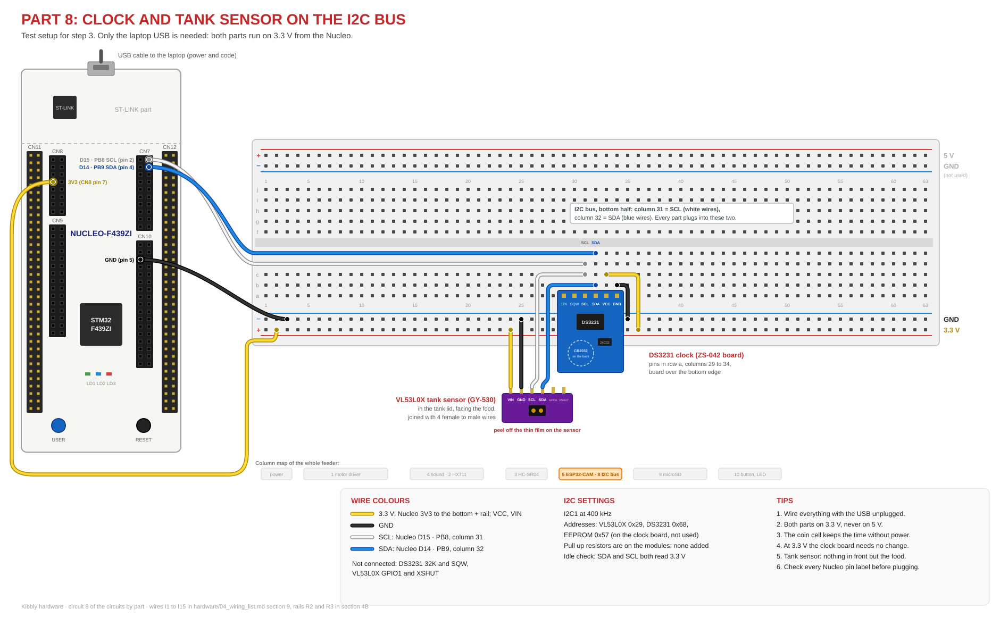

# Circuit 8: Clock and tank sensor on the I2C bus



**What it is for:** the DS3231 clock keeps the real time, even during a power cut (it has its own coin cell), so meals are served on time. The VL53L0X sensor in the tank lid measures the distance down to the food, which gives the tank level and the "low tank" and "empty tank" alerts. Only the laptop USB is needed: both parts run on 3.3 V from the Nucleo.

**Where on the board:** columns 29 to 34, bottom half (see the [column map](../README.md#board-and-column-map)). The clock plugs in there; the tank sensor sits outside the board and joins the same columns with 4 wires.

**Parts:** NUCLEO-F439ZI, DS3231 clock board (ZS-042) with a CR2032 coin cell, VL53L0X sensor (GY-530 board), breadboard, 4 female to male jumper wires for the sensor, other jumper wires, USB cable.

**Wire table:** wires I1 to I15 in [04_wiring_list.md, section 9](../../04_wiring_list.md#9-i2c-bus-vl53l0x-and-ds3231), plus rails R2 and R3 in [section 4B](../../04_wiring_list.md#4b-breadboard-rails-and-power-entries).

## How the bus works

```
Nucleo PB8 (SCL) ──┬── DS3231 SCL ──┬── VL53L0X SCL      column 31
Nucleo PB9 (SDA) ──┴── DS3231 SDA ──┴── VL53L0X SDA      column 32
```

I2C is a bus: **two wires shared by every part**. SCL is the clock the Nucleo ticks, SDA carries the data both ways. Each part has its own address, so the Nucleo calls one at a time and only that one answers.

| Part | Address | What the Nucleo asks |
|---|---|---|
| VL53L0X | 0x29 | Distance to the food, in mm |
| DS3231 | 0x68 | Date and time; the Nucleo also sets it from the internet time sent by the ESP32-CAM |
| EEPROM on the clock board | 0x57 | Nothing (not used) |

On the breadboard this is simple: **column 31 (bottom half) is the SCL bus and column 32 the SDA bus**. Every SCL wire goes into column 31 and every SDA wire into column 32, in any free hole. The clock's own SCL and SDA pins already sit in these two columns.

The clock board has pull up resistors on SDA and SCL, which the bus needs, so no resistor is added.

## The clock

The 6 pins of the ZS-042 board plug into **row a, columns 29 to 34** (32K, SQW, SCL, SDA, VCC, GND), with the board over the bottom edge. Check the names printed on your board.

| Pin | Wire | Why |
|---|---|---|
| SCL, SDA | None: the pins sit in the bus columns 31 and 32 | |
| VCC (column 33) | To the bottom + rail (3.3 V), column 36 | Power |
| GND (column 34) | To the bottom − rail, column 35 | Ground |
| 32K, SQW | None | Extra clock outputs, not used |

Put a **CR2032 coin cell** in the holder on the back: it keeps the time when the feeder is unplugged. The ZS-042 has a small charging circuit meant for rechargeable cells; at 3.3 V it cannot push current into a 3 V coin cell, so the board can be used as it is. Remove its 200 ohm charging resistor (marked 201) only if the board ever runs on 5 V.

## The tank sensor

The VL53L0X sends a tiny invisible laser pulse and times its return, so it measures the distance to the food in mm, in light or in the dark. It goes in the tank lid, facing down at the food, joined with 4 female to male wires:

| Sensor pin | Goes to | Colour |
|---|---|---|
| VIN | Bottom + rail (3.3 V), column 24 | Yellow |
| GND | Bottom − rail, column 25 | Black |
| SCL | Column 31, row c (SCL bus) | White |
| SDA | Column 32, row b (SDA bus) | Blue |
| GPIO1, XSHUT | None | Not needed: the sensor is always on |

**Peel off the thin protective film** on the sensor window before testing; with the film on, the readings are wrong. Keep the space in front of the sensor clear: only the food should be in its view.

## Wiring order

1. USB unplugged.
2. Rails: R3 (Nucleo GND to the bottom − rail), R2 (Nucleo 3V3 to the bottom + rail).
3. Coin cell into the clock board, then push the clock into row a, columns 29 to 34.
4. I10: GND (column 34, row b) to the bottom − rail, column 35. I9: VCC (column 33, row c) to the bottom + rail, column 36.
5. I1: Nucleo D15 · PB8 (CN7 pin 2) to column 31, row d. I2: Nucleo D14 · PB9 (CN7 pin 4) to column 32, row e.
6. Tank sensor, with 4 female to male wires: I4 (GND to the bottom − rail, column 25), I6 (SCL to column 31, row c), I5 (SDA to column 32, row b), then I3 (VIN to the bottom + rail, column 24).
7. Check before powering:
   1. Every white wire ends in column 31 and every blue wire in column 32, bottom half.
   2. Both VCC and VIN go to the bottom + rail (3.3 V), not to the top + rail (5 V).
8. Plug in the USB.

## First test

1. Bus scan: the test program lists the addresses that answer. It must find 0x29, 0x57 and 0x68.
2. Clock: set the time once, unplug the USB for a minute, plug it back: the time must still be right.
3. Tank sensor: hold a flat object 10 cm and then 30 cm in front of it: the readings must follow, within about 1 cm.
4. The test program and the results table come with the step 3 test file for this part.
