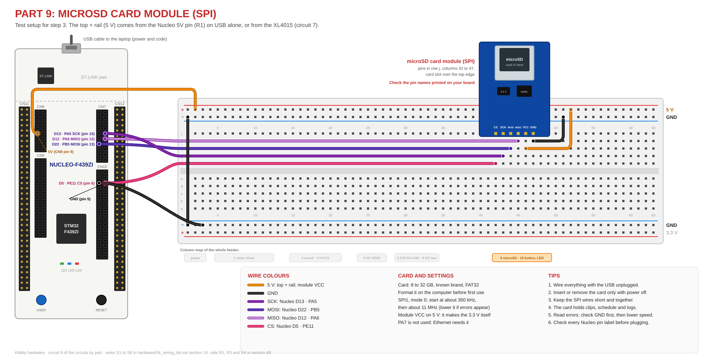

# Circuit 9: microSD card module (SPI)



**What it is for:** the feeder's memory. The card holds the voice clips recorded in the app, a copy of the schedule (so meals still run without WiFi) and the meal logs written while offline, which are uploaded when WiFi comes back. The demo does not need it (its 2 or 3 clips sit in the STM32 memory); this circuit comes after the demo essentials.

**Where on the board:** columns 42 to 47, top half, with the card slot over the top edge; its board covers the top rail holes of columns 40 to 49. VCC and GND go to the top rails at columns 52 and 51 (see the [column map](../README.md#board-and-column-map)).

**Parts:** NUCLEO-F439ZI, microSD card module (SPI, 6 pins), microSD card of 8 to 32 GB from a known brand, breadboard, jumper wires, USB cable.

**Wire table:** wires S1 to S6 in [04_wiring_list.md, section 10](../../04_wiring_list.md#10-microsd-card), plus rails R1, R3 and R4 in [section 4B](../../04_wiring_list.md#4b-breadboard-rails-and-power-entries).

## How it talks

```
Nucleo PA5  (SCK)  ──► clock: one tick per bit
Nucleo PB5  (MOSI) ──► data from the Nucleo to the card
Nucleo PA6  (MISO) ◄── data from the card to the Nucleo
Nucleo PE11 (CS)   ──► "you": low = the card listens
```

SPI is a fast link with 4 wires. The Nucleo drives the clock and sends and receives one bit per tick on two separate wires; CS tells the card that the Nucleo is talking to it. On the STM32, the FatFs library then reads and writes ordinary files, so a clip copied on the computer opens on the feeder and the other way round.

The module has its own **3.3 V regulator** (the card runs on 3.3 V) and a small buffer chip, so its VCC goes on the **5 V** rail.

## The module on the breadboard

The 6 pins plug into **row j, columns 42 to 47**, and the board stands over the top edge with the card slot outward, so a card can go in and out without unplugging anything. The picture shows the usual pin order of these modules, CS, SCK, MOSI, MISO, VCC, GND from left to right; **check the names printed on your board**. If they read the other way (GND first), do not turn the board over the breadboard: keep it next to the board instead and join it with 6 female to male wires, by name.

Why columns 42 to 47 and not 36 to 41: the module covers the top rail holes on both sides of its pins, and the rails at columns 36 to 39 already hold the ESP32-CAM 5 V, GND and capacitor (circuit 5).

| Module pin | Column | Goes to | Colour |
|---|---|---|---|
| CS | 42 | Nucleo D5 · PE11 (CN10 pin 6), from row f | Pink |
| SCK | 43 | Nucleo D13 · PA5 (CN7 pin 10), from row g | Purple |
| MOSI | 44 | Nucleo D22 · PB5 (CN7 pin 13), from row h | Dark purple |
| MISO | 45 | Nucleo D12 · PA6 (CN7 pin 12), from row i | Light purple |
| VCC | 46 | Top + rail (5 V), column 52, from row h | Orange |
| GND | 47 | Top − rail, column 51, from row i | Black |

Each SPI wire sits one row lower than the column on its right, so no wire passes over another wire's end. MOSI uses PB5 and not PA7, because PA7 belongs to the Nucleo's Ethernet.

## The card

1. 8 to 32 GB, from a known brand: cheap unbranded cards fail often.
2. Format it as **FAT32** on the computer before first use (cards of 64 GB and more come as exFAT; stay at 32 GB or less).
3. Insert or remove it only with the power off.

## Speed

The card starts at a slow clock (about 350 kHz), then the program raises it to about 11 MHz. Through jumper wires 11 MHz can give read errors; if the test reports any, lower the SPI speed one step at a time (5.6 MHz, then 2.8 MHz). Short SPI wires kept together help.

## Wiring order

1. USB unplugged, card out.
2. Rails: R4 (join the two GND rails, column 1), R3 (Nucleo GND), and the 5 V feed: R1 (Nucleo 5V to the top + rail) for a test on USB alone, or the XL4015 of circuit 7 if it is already wired. Never both.
3. Push the module into row j, columns 42 to 47.
4. S2: GND (column 47, row i) to the top − rail, column 51. S1: VCC (column 46, row h) to the top + rail, column 52.
5. S4: MISO (column 45, row i) to Nucleo PA6. S5: MOSI (column 44, row h) to Nucleo PB5. S3: SCK (column 43, row g) to Nucleo PA5. S6: CS (column 42, row f) to Nucleo PE11.
6. Check: VCC on the top + rail (5 V); every SPI wire on the Nucleo pin of the same name.
7. Card in, then plug in the USB.

## First test

1. The test program mounts the card and lists its files: a file copied on the computer must show up.
2. Write a test file of 1 MB, read it back and compare: no error.
3. Play a WAV clip from the card through the amplifier (with circuit 4).
4. The test program and the results table come with the step 3 test file for this part.
