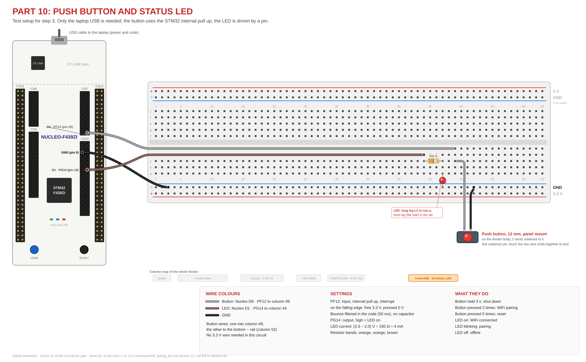

# Circuit 10: Push button and status LED



**What it is for:** the only controls on the feeder itself. The button handles WiFi pairing, reset and shut down; the LED shows the WiFi status. Only the laptop USB is needed: neither part needs the 3.3 V rail.

**Where on the board:** columns 44 to 49, bottom half (see the [column map](../README.md#board-and-column-map)). The button sits outside the board, on the feeder body.

**Parts:** NUCLEO-F439ZI, push button (12 mm, panel mount, 2 terminals), LED (5 mm) with a 330 ohm resistor, one 100 nF ceramic capacitor (marked 104), breadboard, jumper wires, USB cable.

**Wire table:** wires B1 to B4 and L1 to L3 in [04_wiring_list.md, section 12](../../04_wiring_list.md#12-button-and-led), plus rail R3 in [section 4B](../../04_wiring_list.md#4b-breadboard-rails-and-power-entries).

## What they do

| Action | Result |
|---|---|
| Button held 3 s | Shut down: motor disabled, feeder asleep |
| Button pressed 2 times (within 2 s) | WiFi pairing: the STM32 sends `PAIR` to the ESP32-CAM |
| Button pressed 5 times | Reset the feeder |
| LED on | Connected to WiFi |
| LED blinking | Pairing mode |
| LED off | Offline |

The full press logic is in [step 2, section 13](../../02_system_architecture.md#13-button-and-led).

## How the button works

```
3.3 V ── internal pull up (inside the STM32) ──┬── PF12
                                              ├── button ── GND
                                              └── 100 nF ── GND
```

PF12 is set as an input with the STM32's **internal pull up**, so no resistor is needed: free, the pin reads 3.3 V; pressed, the button joins it to GND and it reads 0 V. A press is the fall from 3.3 V to 0 V, which starts an interrupt.

A mechanical button **bounces**: one press makes several fast contacts. The 100 nF capacitor with the pull up smooths these into one clean fall (a few milliseconds), so "pressed 2 times" is not counted as 6. The program also ignores presses closer than about 50 ms, as a second safety.

| Button wire | Goes to | Colour |
|---|---|---|
| One terminal | Column 49, row c (the PF12 column) | Grey |
| The other terminal | Bottom − rail, column 52 | Black |

A panel button has 2 terminals and no polarity: either wire on either terminal. Solder the 2 wires to it (ask Hedi or the lab), ending in male pins for the breadboard.

**Not bought yet?** Test with the 2 wire ends alone: touching them together is a press.

## How the LED works

```
PG14 ── 330 ohm ── LED long leg (+) ── LED short leg ── GND
```

PG14 high (3.3 V) turns the LED on. The 330 ohm resistor limits the current to about 4 mA ((3.3 − 2.0) V ÷ 330 ohm), bright enough and safe for both the LED and the pin. **Never connect an LED to a pin without its resistor.**

| Part | Where |
|---|---|
| 330 ohm resistor (orange, orange, brown) | Lying flat in row c, from column 44 to column 47 |
| LED long leg (+, anode) | Column 47, row a |
| LED short leg (flat side of the rim, cathode) | Bottom − rail, column 47 |

If the LED stays dark when it should be on, it is probably the wrong way round: turn it.

## Wiring order

1. USB unplugged.
2. Rail: R3 (Nucleo GND to the bottom − rail).
3. L2: 330 ohm resistor flat in row c, columns 44 and 47. L3: LED, long leg in column 47 row a, short leg in the bottom − rail.
4. B3: 100 nF capacitor from column 49 row a to the bottom − rail.
5. L1: column 44 (row d) to Nucleo D1 · PG14 (CN10 pin 14). B4: column 49 (row e) to Nucleo D8 · PF12 (CN7 pin 20).
6. Button: B1 into column 49, row c; B2 to the bottom − rail, column 52.
7. Check: LED long leg in row a; no wire from the button to a + rail.
8. Plug in the USB.

## First test

1. The test program blinks the LED once per second.
2. Each press of the button prints one line on the laptop: one line per press, never more.
3. Press 2 times, 5 times, then hold 3 s: the program must report "pairing", "reset" and "shut down".
4. The test program and the results table come with the step 3 test file for this part.
