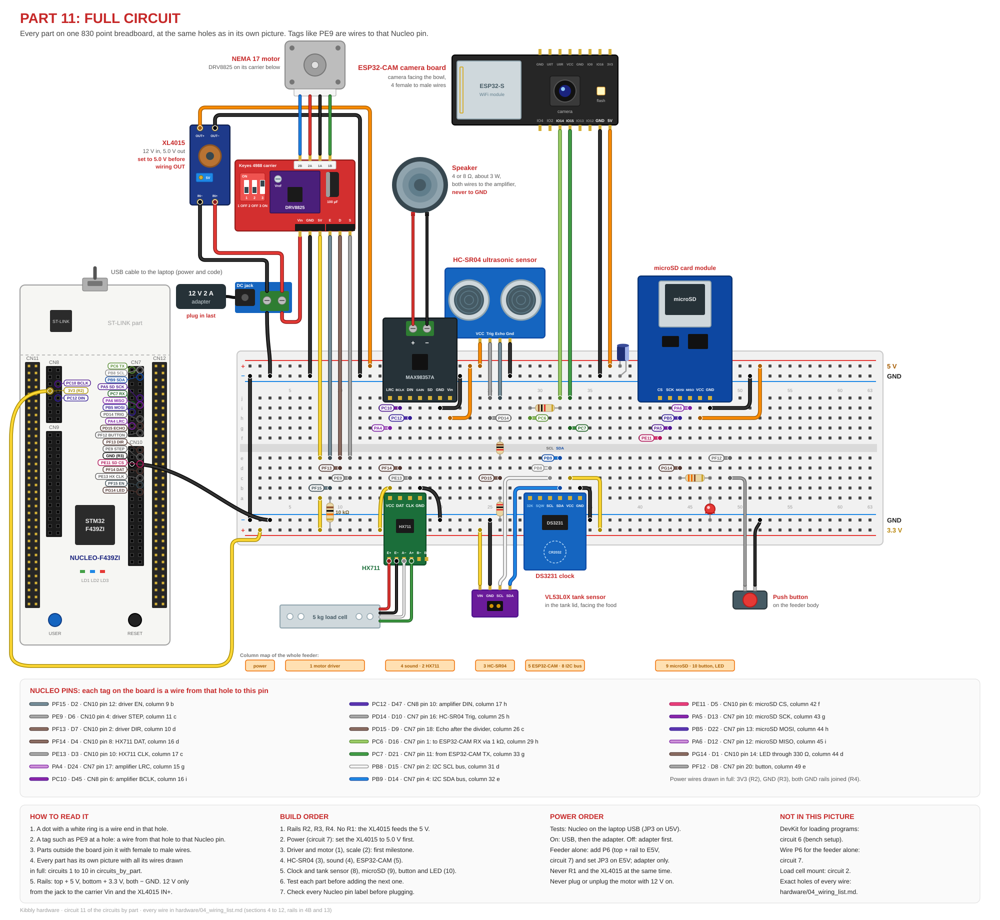

# Circuit 11: Full circuit



**What it is:** every part of the feeder on one 830 point breadboard, at the same holes as in its own picture (circuits 1 to 5 and 7 to 10). Checked by script: 102 holes are used and none is used twice, and no wire goes into a hole covered by a module (the amplifier, the microSD module, the HX711 and the clock).

**Wire table:** every wire is in [04_wiring_list.md](../../04_wiring_list.md), sections 4 to 12, with the rails in sections 4B and 13 and the checklist in section 15.

## How to read it

1. **Parts outside the board** (adapter, XL4015, motor, speaker, HC-SR04, ESP32-CAM, load cell, tank sensor, button) are placed around it so that nothing overlaps; their wires end at the same holes as in their own pictures. In the real feeder they go where their pages say: the HC-SR04 and the camera facing the bowl, the tank sensor in the lid, the button on the body.
2. **The 20 signal wires to the Nucleo are drawn as tags.** Drawn in full, they would cross the motor wires and the driver, which fill rows f to j of columns 5 to 12, and the picture could not be read. At the board, a short wire ends in a tag naming the Nucleo pin (for example **PE9**); next to the Nucleo, the same tag points at that pin. Each part picture shows these wires in full.
3. **Power wires are drawn in full:** 12 V from the jack, the XL4015 and its 5 V output, 3V3 (R2), GND (R3) and the link between the two GND rails (R4).

## Nucleo pins

Every tag, with the pin printed on the board and the header pin (numbers from the user manual UM1974: check them on the board before plugging).

| Tag | Board label | Header pin | Goes to | Hole |
|---|---|---|---|---|
| PF15 | D2 | CN10 pin 12 | Driver EN (10 kohm to 3.3 V keeps the motor off) | Column 5, row b |
| PE9 | D6 | CN10 pin 4 | Driver STEP | Column 11, row c |
| PF13 | D7 | CN10 pin 2 | Driver DIR | Column 12, row d |
| PF14 | D4 | CN10 pin 8 | HX711 DT | Column 16, row d |
| PE13 | D3 | CN10 pin 10 | HX711 SCK | Column 17, row c |
| PA4 | D24 | CN7 pin 17 | Amplifier LRC | Column 15, row g |
| PC10 | D45 | CN8 pin 6 | Amplifier BCLK | Column 16, row i |
| PC12 | D47 | CN8 pin 10 | Amplifier DIN | Column 17, row h |
| PD14 | D10 | CN7 pin 16 | HC-SR04 Trig | Column 25, row h |
| PD15 | D9 | CN7 pin 18 | HC-SR04 Echo, after the divider | Column 26, row c |
| PC6 | D16 | CN7 pin 1 | ESP32-CAM RX, through 1 kohm | Column 29, row h |
| PC7 | D21 | CN7 pin 11 | ESP32-CAM TX | Column 33, row g |
| PB8 | D15 | CN7 pin 2 | I2C SCL bus (clock and tank sensor) | Column 31, row d |
| PB9 | D14 | CN7 pin 4 | I2C SDA bus | Column 32, row e |
| PE11 | D5 | CN10 pin 6 | microSD CS | Column 42, row f |
| PA5 | D13 | CN7 pin 10 | microSD SCK | Column 43, row g |
| PB5 | D22 | CN7 pin 13 | microSD MOSI | Column 44, row h |
| PA6 | D12 | CN7 pin 12 | microSD MISO | Column 45, row i |
| PG14 | D1 | CN10 pin 14 | LED, through 330 ohm | Column 44, row d |
| PF12 | D8 | CN7 pin 20 | Button | Column 49, row e |
| 3V3 | 3V3 | CN8 pin 7 | Bottom + rail (wire R2) | Column 2 |
| GND | GND | CN10 pin 5 | Bottom − rail (wire R3) | Column 3 |

## Build order

Build and test one part at a time, in this order; each part keeps working when the next one is added, because no two parts share a hole.

1. Rails: R4 (join the two GND rails), R3 (Nucleo GND), R2 (Nucleo 3V3). **No R1**: from now on the XL4015 feeds the 5 V.
2. Power, [circuit 7](../07_power/README.md): set the XL4015 to 5.0 V with a multimeter **before** its output touches the board.
3. Driver and motor, [circuit 1](../01_stepper_motor_drv8825/README.md), then the scale, [circuit 2](../02_load_cell_hx711/README.md): the first milestone.
4. HC-SR04, [circuit 3](../03_ultrasonic_hc_sr04/README.md); sound, [circuit 4](../04_sound_max98357a/README.md); ESP32-CAM link, [circuit 5](../05_esp32_cam_link/README.md), with its program loaded through [circuit 6](../06_esp32_cam_flashing/README.md).
5. Clock and tank sensor, [circuit 8](../08_i2c_clock_tank/README.md); microSD, [circuit 9](../09_microsd_card/README.md); button and LED, [circuit 10](../10_button_led/README.md).
6. After each part: run its first test (its page), then go through the [checklist](../../04_wiring_list.md#15-checklist-before-powering-on) before the next power on.

## Power order

| | Tests (laptop next to the feeder) | Feeder alone |
|---|---|---|
| Nucleo power | Laptop USB, JP3 on U5V | Wire P6 (top + rail to E5V) and JP3 on E5V ([circuit 7](../07_power/README.md)) |
| Power on | USB, then the adapter | Adapter only; USB after it for logs |
| Power off | Adapter, then the USB | USB, then the adapter |

Never R1 and the XL4015 at the same time, and never plug or unplug the motor with 12 V on.

## Not in this picture

1. The ESP32 DevKit used to load programs into the ESP32-CAM: a bench setup, [circuit 6](../06_esp32_cam_flashing/README.md).
2. Wire P6, only when the feeder runs alone: [circuit 7](../07_power/README.md).
3. How to mount the load cell under the bowl: [circuit 2](../02_load_cell_hx711/README.md).

## Editing the picture

```
cd 11_full_circuit
python3 make_11_full_circuit.py 11_full_circuit.svg
```

If a part moves to other holes, change its own picture, the wiring list and this script together, then check again that no hole is used twice.
